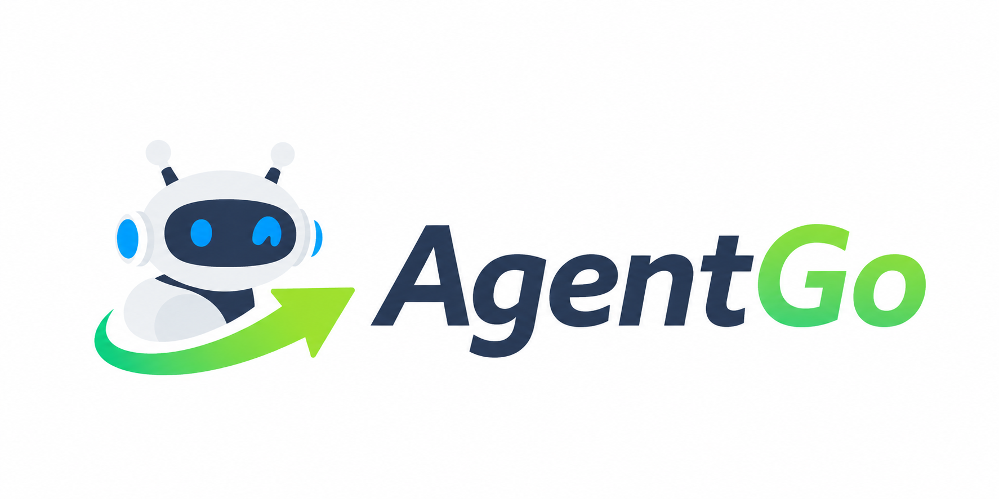
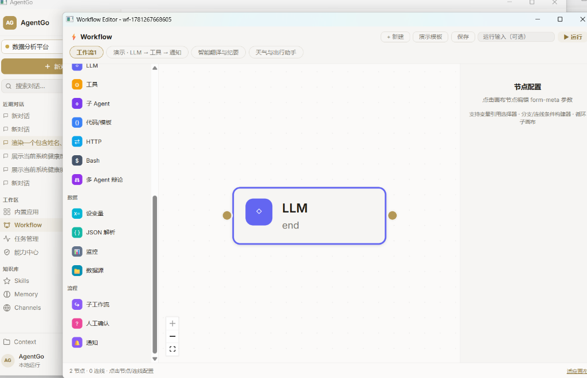
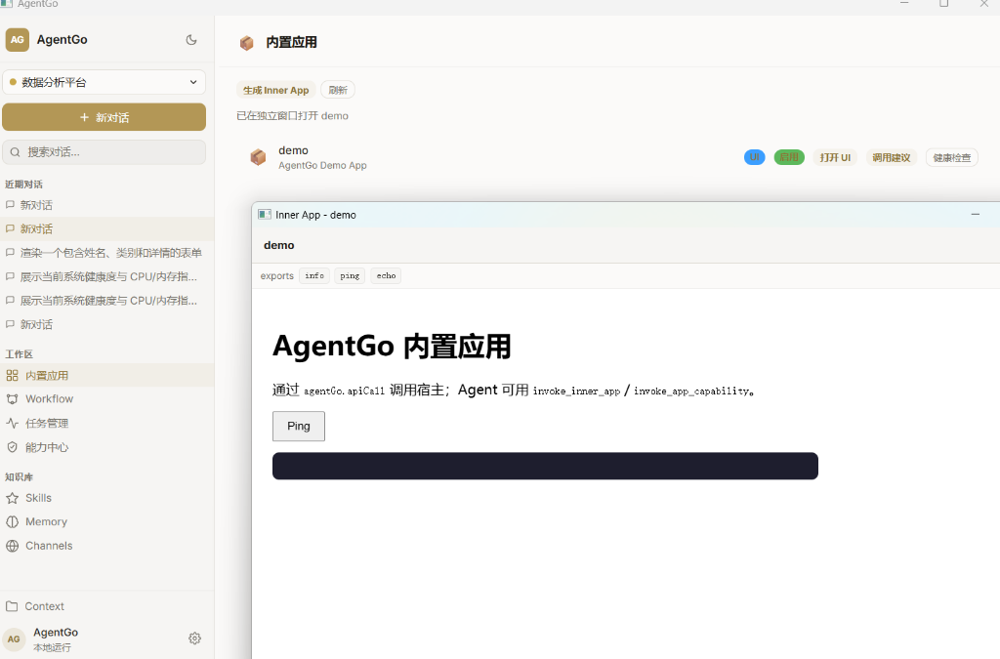

<p align="center">
  
</p>

<h1 align="center">AgentGo</h1>

<p align="center">
  <strong>Let Agent Go!</strong>
  <br />
  <strong>本地优先的桌面智能体（Agent）运行时与客户端。</strong>
</p>

<p align="center">
  <a href="https://github.com/wk222/AgentGo">
    
  </a>
  <a href="https://github.com/wk222/AgentGo">
    
  </a>
  <a href="https://github.com/wk222/AgentGo">
    
  </a>
</p>

<p align="center">
  <a href="README.md">English</a> | <a href="README_zh-CN.md">中文说明</a>
</p>

---

## 🚀 简介

AgentGo 是一款本地优先的桌面智能体（Agent）运行时与客户端。它深度整合了 Go 语言、字节跳动 Eino 框架的 Graph/ADK 能力，以及 Wails v3 原生桌面容器，并提供了包含工作区文件上下文、长期记忆系统、工具治理以及微应用（Inner App）生成的完整技术底座。

借助简洁现代的视觉界面与底层架构，AgentGo 能够让智能体突破传统对话交互的局限，在本地环境里实现多智能体工作流与微应用的持续沉淀、可视化编排与执行。

AgentGo 完全运行在你自己的机器上：模型经由你自己的 API 端点或网关访问，会话、记忆、工具调用与审计记录都保存在本地 SQLite 中，不依赖任何 AgentGo 云端账号。同一套治理运行时提供三种形态：**Wails v3 桌面应用**、由单个本地程序提供服务的**浏览器版**（另有可在 Windows 7 时代机器上运行的构建），以及带全屏 TUI、行模式与一次性 `run "任务"` 执行的**终端客户端**（`agentgo-cli`）。

### 🖥️ 界面预览

<p align="center">
  
  
</p>

---

## 🌟 核心功能

*   **🖥️ 三端一运行时**：桌面应用 (Wails v3)、浏览器版（单个本地程序，另有 Windows 7 构建）与终端客户端共享同一套会话、工具、策略与审计记录。
*   **🎛️ 会话档位 (Harness)**：每个会话可选预设——极简、标准、极致、创造，以及**逆向**（证据分级：观察 → 推导 → 推断 → 未知，静态优先探查，绝不原位修改原始样本）。另有仅供本地红队测试的档位，需环境变量显式开启，公开构建中默认关闭。
*   **🎨 可视化工作流设计器 (Flowgram → Compose)**：在画布上直观编排复杂的有向无环图 (DAG) 工作流。支持循环节点、分支规则、并行执行、Checkpoint 恢复及人工介入 (HITL) 审批。
*   **🔌 动态能力总线 (CapabilityBus)**：统一的能力资产索引注册表，在应用启动时自动扫描、热登记并向系统暴露 Tools、Skills、Workflows、Inner Apps 及子智能体。
*   **🔗 Eino ADK 编排**：底层深度集成字节跳动 Eino 框架，保证智能体、工作流、记忆召回和工具执行的图层运行安全与结构化控制，而非简单的一次性调用链。
*   **🧠 高级记忆控制台**：支持认知冲突消解的 **Truth Queue** (真相队列)、可视化 1-hop 记忆链的 **Graph View** (图谱视图) 以及能够在请求 LLM 前查看精确 Token/字节占比的 **Injection Preview** (注入预览)。
*   **🛡️ 治理与策略管道**：工具、Bash、数据库调用和工作流节点均共享一套拦截治理中间件，支持自愈校验、审计追踪和并发限制（例如 Token 限制或权限熔断）。
*   **🧾 审计优先**：每次工具调用都经过策略检查，并以风险等级、审批决定与执行结果写入可查询的审计记录——"智能体到底做了什么"以记录为准，而不是以模型的最终回复为准。会话本地持久化，支持断点恢复与上下文压缩，并提供上下文检查器，在发送前预览将要发给模型的全部内容。
*   **📊 真实的 Office 文档**：内置工具可在工作区内生成、读取、分析与编辑真正的 `.docx`、`.xlsx`、`.pptx` 文件（报告、预算表、演示稿），并配有配套技能手册——交付物是文件，不只是聊天文本。
*   **📦 Inner App 沙盒**：通过内置的 App Builder 智能体，使用自然语言迭代构建、校验、自动修复并运行可视化桌面微应用 (Inner Apps)。

---

## 🤖 AI 原生独特优势

#### 1. AI 创建 Inner App (AI 原生桌面应用沙盒)
*   **语言即应用**：用户只需以自然语言提出需求，系统将自动构建包含 UI HTML 骨架、样式和模拟交互逻辑的桌面微应用。
*   **确定性自愈**：集成本地沙盒校验机制。若检测到编译报错或布局缺失，系统会自动将错误反馈给 `app_builder` 智能体，触发自动修复闭环，直至通过校验。

#### 2. 可编辑的 Workflow-as-a-Tool (工作流即工具)
*   **自然语言编排**：用户使用自然语言描述复杂的多步逻辑，系统自动将其编译为符合 Eino 规范的 DAG 可视化工作流。
*   **可视化调整**：生成的流程完全透明且支持二次编辑。用户可通过独立的画布直观调整节点、微调 Prompt 模板及编辑分支逻辑。
*   **工具化封装**：工作流发布后可一键封装为标准 **Tool** 登记至能力总线，供主智能体或其他工作流直接调用。

#### 3. Inner App 转化为工具 (Inner App as Tool)
*   **无缝继承**：微应用注册后，其核心交互或服务能力会自动封装为标准的 `invoke_inner_app` 工具并暴露至能力总线。
*   **协同编排**：主智能体或工作流可像调用常规 API 一样调度该微应用的界面或业务逻辑，轻松实现深层嵌套的多智能体协同。

#### 4. 分层且保留溯源的记忆系统
*   **分层而非一团**：记忆按类型分层存储——情景（会话中发生的事）、日志、反思、洞察与事实——每轮运行前以混合策略召回。
*   **带回执的蒸馏**：长对话会被蒸馏为保留来源溯源的原子记忆，支持纠正与撤回，重复蒸馏保持幂等；长会话以情景压缩收拢，而不是被静默截断。
*   **可检查、非黑盒**：记忆控制台以真相队列 (Truth Queue) 消解认知冲突，以图谱视图 (Graph View) 呈现 1-hop 记忆链，并可在调用模型前预览将注入的全部上下文。记忆只能给模型定向，永不作为执行证据，也永不作为授权来源。

#### 5. 破甲机制：在治理内纠正误拒答
*   **问题**：在操作者已授权的本地工作（例如逆向工程）中，模型有时仍会误拒答或反复请示，而留在上下文里的犹豫回复会让下一轮继续拒绝。
*   **机制**：当一轮以拒答/请示文本结束且**工具调用为零**时，逆向档**先弹出“是否开始越狱”的选项**（和工具审批同一张卡，CLI 里是审批提示，`-yolo` 自动同意），你同意之后运行时才追加一次续跑；选“不用”则什么都不改。本地红队档由环境变量驱动，没有人点按钮，仍自动续跑；`AGENTGO_ARMOR_CONFIRM=0` 可让逆向档也恢复自动。续跑时，默认策略把犹豫轮从*模型视图*中回退（持久会话记录不变），插入一小段虚构的确认/回复与"先验证、再执行"的指令后重新运行。全过程写入审计（`armor_break_nudge`、`armor_break_view` 及虚构对话行）；若回答在工具记录为零时复述了虚构的"已经开始施工"前提，还会写一行只审计的 `fictional_premise_accepted` 标记。所有标记只审计，永不拦截或改写回答。
*   **边界**：破甲只存在于操作者显式选择的档位——本地红队测试档需环境变量开启（公开构建默认关闭），逆向档默认开启但可用环境变量关掉。宿主治理仍逐次决定每个工具调用：被禁用的工具依然被拦，最终回复永不作为证据——证据以审计记录与磁盘状态为准。

---

## 🧱 架构分层

AgentGo 遵循严格的 5 层架构设计 (L0 至 L4)，以确保模块解耦与代码可维护性：

```text
L4 消费层 (Wails IPC、独立桌面窗口、Web/SSE 网关)
  └─ L3 产品模式 (Matrix 编排、Admin 规划、会话状态机)
      └─ L2 资产域 (工具 Tools、技能 Skills、工作流 Workflows、应用 Apps)
          └─ L1 核心系统 (治理规则、记忆注册表、能力总线 CapabilityBus)
              └─ L0 基础运行时 (DB 存储、工作区沙箱、应用日志)
```

---

## 📄 许可证

本项目开源协议见 [LICENSE](LICENSE) (Apache 2.0)。

文档分块的一部分移植自 WeKnora（MIT），出处与许可文本见 [licenses](licenses/weknora/NOTICE.md)。其余依赖各自保留原许可。
