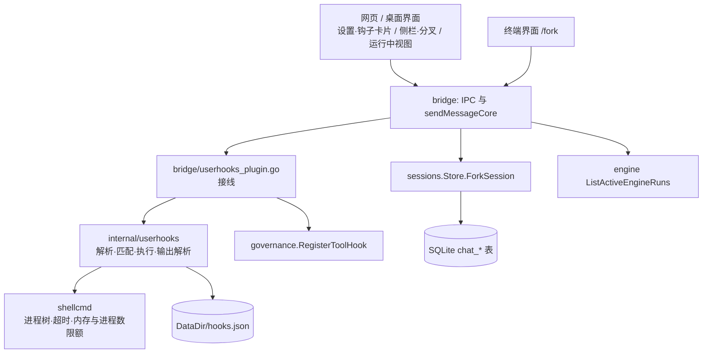

# 用户钩子、会话分叉与运行中视图：系统设计（2026-10-28）

状态（2026-10-28）：五个决定都已确认，施工顺序为 M1 → M2 → M3 → M4。**M1、M2（用户钩子）、M3（会话分叉）和 M4（运行中视图）都已完成并验证**，施工记录和限制见第 8 节。

资料来源：AgentGo 一侧来自读代码（文中给出文件路径）；Codex 一侧来自本机克隆 `..\codex-reference`（提交 c8091ae，2026-10-27），路径都相对 `codex-rs\`。没有试用 Claude Code，凡写到它的地方来自 Codex 源码里的注释和之前的发布说明。

## 0. 目标与约束

**交付物**

- A. 用户钩子：用户自己写的脚本，挂在"工具调用前后、提交消息前、一轮结束后"，能拦截、能记录、能通知。
- B. 会话分叉：把一段对话复制成一个新会话，两边各走各的。
- C. 运行中视图：集中看哪些会话、后台任务、子智能体正在跑，能跳过去、能停。

**运行环境**：Windows（含 Win7）单 exe，办公内网；SQLite 单库，桌面、终端界面、无头模式共用同一个库。

**预算**（凭经验估的，标"未验证"）

| 项 | 预算 | 状态 |
| --- | --- | --- |
| 一个钩子的额外耗时 | 进程启动 + 脚本本身；超时默认 30 秒，最长 600 秒 | 未验证 |
| 一次工具调用上，匹配到的钩子数 | 最多 20 个 | 未验证 |
| 分叉耗时 | 10 MB 事件日志在 1 秒内；复制在库内完成，不经过 Go 内存 | 未验证，施工时用 50 MB 实测 |
| 钩子输出 | 每个钩子每路最多保留 64 KiB | 未验证 |

**成功标准**

- 钩子：一个"拦截 `rm -rf`"的 PreToolUse 钩子，在真实模型会话里真的挡住命令，并且模型看得到拦截原因；没有 `hooks.json` 时行为和现在完全一样。
- 分叉：在会话 A 里让模型记住一个代号，分叉出 B，在 B 里问得出代号；之后 A、B 各自追加消息互不影响；删掉 A，B 还在。
- 运行中视图：同时跑 3 个会话时，视图里 3 个都在，点一个能跳过去，点停止能停；刷新页面后仍然正确。

## 1. 现状与参照（证据）

### 1.1 钩子

| | Codex（`hooks` crate） | AgentGo 现有 |
| --- | --- | --- |
| 事件 | 13 个：SessionStart、SessionEnd、UserPromptSubmit、PreToolUse、PostToolUse、PermissionRequest、Stop、SubagentStart、SubagentStop、PreCompact、PostCompact、ModelRequest、Interrupt（`hooks/schema/generated/*.json`） | 只有"工具前/后"两个点（`internal/governance/tool_hooks.go`） |
| 契约 | 脚本从 stdin 读一份 JSON；退出码 0 成功（stdout 是 JSON 就解析）；**退出码 2 = 拦截，stderr 是原因**；其他退出码、超时 = 钩子自己失败，不拦截。输出字段：`continue`、`decision`、`reason`、`stopReason`、`systemMessage`、`hookSpecificOutput`（`additionalContext`、`permissionDecision` allow/deny/ask、`updatedInput`）（`hooks/src/events/pre_tool_use.rs` 的 `Some(2)` 分支、各 `*.output.schema.json`）。schema 注释明说这一套与 Claude 对齐 | `Before` 返回 error = 否决；`After` 只观察；panic 当否决（Before）或忽略（After） |
| 匹配 | 空或 `*` 匹配全部；只含字母数字下划线和 `|` 时按名字精确匹配（如 `Bash|Edit`）；其余按正则（`hooks/src/engine/matcher.rs`） | 无 |
| 配置 | 用户层、项目层、托管层三层；项目层要先"信任"（有指纹），可强制只用托管钩子（`hooks/src/engine/discovery.rs` 里的 `allow_managed_hooks_only`、`bypass_hook_trust`，`plugin_trust.rs`）。信任的细节我没有细读 | 没有用户入口，只有 Go 插件能注册 |
| 触发时机 | PreToolUse 的输出可以带 `permissionDecision`（allow / deny / ask），说明它在审批决定之前运行；另有独立的 PermissionRequest 钩子 | **在审批通过之后、真正执行之前**；还在等审批、被拒绝、被策略否决的调用到不了钩子 |

AgentGo 这边还有三条会影响设计的事实：

1. 所有聊天入口汇合在 `sendMessageCore`（`internal/bridge/message.go`）：网页 IPC（`app_ipc.go:394`）、流式（`stream.go:86`）、ACP（`acp_handler.go:99`）、Eino 引擎（`engine_eino.go:26`）都调它。"提交消息前"和"一轮结束后"两个点钩在这里，一次覆盖。终端界面经引擎层进入，入口我没有逐行核对。
2. `Before` 只能否决，不能改参数，也不能说"免审批"；`After` 不能改结果。所以 Codex 的 `updatedInput`、`allow`、`ask` 这几项，AgentGo 第一版做不了，要改 governance 才行。
3. 同一轮里的多个工具调用默认并行执行，钩子可能并发运行。

### 1.2 会话分叉与并行

| | Codex | AgentGo 现有 |
| --- | --- | --- |
| 分叉语义 | `ForkSnapshot`：`TruncateBeforeNthUserMessage(n)`（截到第 n 条用户消息之前）和 `Interrupted`（按"刚被打断"的状态复制，半轮时补一个 `<turn_aborted>` 标记）（`core/src/thread_manager.rs:205`）。新会话有自己的 ID 和指向父会话的引用 | 没有分叉入口 |
| 文件隔离 | `worktree` crate：为会话建一个受管的 git worktree，有保留数量上限（`worktree/src/lib.rs` 的 `WorktreeManager`） | 没有；多个会话共用同一个工作区，改同一个文件会互相覆盖，没有文件锁（`docs/xlsx-access-elevation-2026-10-27.md` 第 2 节） |
| 并行 | 多线程由 `ThreadManager` 管 | 已实测：3 个会话同时跑，时间窗口重叠，事件按 `session_id` 分流，答案各自正确；侧栏已有 running / awaiting 徽标；`ListActiveEngineRuns()` 能给出权威的运行列表（`internal/engine/router.go` 的 `ActiveRun{RunID, Engine, SessionID, StartedAt}`）；子智能体以工具卡片出现在转录里（`FlowChatTranscript.tsx`）；后台任务有 `StartBackgroundTask` / `ListBackgroundTasks` 和任务面板 |

**需要更正之前的说法**：`docs/frontier-agents-gap-2026-10-28.md` 写"会话存储里有分叉和游标回退的实现，只缺调用方"。读完发现这个底座**接不上**：

- 模型看到的上下文，真源是 Eino 事件日志，存在 `chat_context_events` 表，scope 是 `eino-v1:<工作区路径哈希>`（`internal/agent/runtime_session_store.go`，文件头注释写明"聊天消息只是界面转录"）。
- `chat_messages` 只是界面转录。
- `internal/sessions/tree.go` 的 `chat_entries` / `chat_lanes`（`ForkLane`、`ResetLaneHead`）是另一份独立的数据，生产代码里没有 `AppendEntry` 的调用方，只有测试用。给它接线，分叉出来的东西模型根本看不到。（2026-10-30 更新：`tree.go` 与它的测试已删除，两张表作为遗留空表保留。）

所以分叉要做成**复制式**：把转录和事件日志一起复制到新会话。计划和任务状态是从消息、事件投影出来的（`internal/sessions/plan_state.go`、`task_state.go`），不用单独复制。（施工时更正：模型自己的**计划任务清单**不是投影，是工作区里按会话分目录的文件，数据库复制带不走，要另外复制，见 8.2。）

## 2. 系统结构

### 2.1 模块图



依赖方向都是向下：界面 → bridge → 引擎/存储 → 基础包。`internal/userhooks` 只依赖标准库、`shellcmd`、`config`，不依赖 governance（接线放在 bridge，避免反向依赖）。

### 2.2 模块说明

| 模块 | 职责 | 对外接口（入 → 出） | 不负责 | 可替换点 |
| --- | --- | --- | --- | --- |
| `internal/userhooks`（新） | 读 `hooks.json`，校验，匹配，执行命令，解析输出，记最近运行 | `Load(path) (Config, []Problem)`；`(*Engine).Fire(ctx, Event) Outcome`；`(*Engine).Status()` | 不认识工具、会话、界面；不做审批；不注册到 governance | 处理器类型：`command`，以后可加 `http` |
| `bridge/userhooks_plugin.go`（新） | 把引擎接到 governance 的 Before/After，接到 `sendMessageCore` 的提交前和一轮结束后，暴露 IPC | `GetHooksStatus()`、`ReloadHooks()` | 不解释钩子输出的细节（引擎负责） | |
| `sessions.Store.ForkSession`（新） | 单个事务内复制会话 | `ForkSession(ctx, srcID, title) (Session, error)` | 不判断源会话是否在运行（调用方判断） | |
| `bridge` 的 `ForkSession` IPC（新） | 检查源会话没在运行、没有待审批；调用存储；返回新会话 | `ForkSession(sessionID, title) {id, title, error}` | | |
| 前端（新增） | 钩子设置卡片；侧栏"分叉"菜单和谱系；`/fork`；运行中面板 | | | |

### 2.3 配置外置清单

| 项 | 位置 | 默认值 | 是否已验证 |
| --- | --- | --- | --- |
| 钩子总开关 | 环境变量 `AGENTGO_USER_HOOKS`（登记在 `internal/config/flags.go`） | 开；没有 `hooks.json` 就什么都不发生 | 否 |
| 钩子超时 | `hooks.json` 每条的 `timeout` | 30 秒，上限 600 秒 | 否 |
| 钩子失败策略 | `hooks.json` 每条的 `onFailure` | `continue`（放行并警告） | 与 Codex 对齐，未在本项目验证 |
| 输出上限 | 常量 | 64 KiB / 路 | 否 |
| 最近运行记录 | 常量 | 内存里 200 条 | 否 |
| 分叉标题 | 常量 | 「原标题（分叉）」，重名时「（分叉 2）」「（分叉 3）」…（施工时改；设计稿原写「原标题 · 分叉」） | — |

### 2.4 新旧共存

- 没有 `hooks.json`，或总开关关闭：`governance.withHooks` 里"没有钩子就直通"的分支（`len(hs) == 0`）照旧，行为和现在一致。
- 分叉是新增接口，不改现有写路径；不用它就没有任何变化。

## 3. 数据结构

### 3.1 实体表

| 实体 | 主键 | 关键字段 | 归属 | 类别 | 版本字段 | 体积 |
| --- | --- | --- | --- | --- | --- | --- |
| `hooks.json` | 文件路径 | `hooks{事件 → [{matcher, hooks[{type, command, timeout, onFailure, async}]}]}` | userhooks | 人工数据（用户写的，不可重算） | 内存里记内容哈希，用于发现变化和审计 | 小于 10 KB |
| HookRun | 递增序号 | 事件、钩子标识（matcher + 命令前 60 字）、开始时间、耗时、退出码、结果（ok / blocked / failed / timeout）、原因（至多 500 字） | userhooks | 派生（可丢） | — | 200 条约 100 KB |
| `chat_session_forks`（新表） | `session_id` | `parent_id`、`parent_title`、`forked_at`、复制的消息条数、事件条数 | sessions | 人工数据（用户的分叉动作产生） | 建表即第一版 | 每个分叉一行 |
| 分叉出的会话 | 新的 `sess_<12 位>` | 复制来的 `chat_messages`、`chat_context_events`、`session_modes` | sessions | 源数据的拷贝 | — | 与源会话相当 |

### 3.2 关系

`chat_session_forks.session_id → chat_sessions.id`（随会话一起删，要加进 `deleteSessionRows` 的表清单）。`chat_session_forks.parent_id` 只存文本，不加外键：父会话被删后分叉出的会话还在，界面显示"原对话已删除"。复制出的行都用新的 `session_id`，不引用源行。

### 3.3 存储

| 数据 | 格式 | 位置 | 写入方式 | 备份 |
| --- | --- | --- | --- | --- |
| `hooks.json` | UTF-8 JSON，Claude 钩子配置的同一形状 | `<数据目录>/hooks.json` | 只由用户编辑；程序不自动写 | 用户自己 |
| 最近运行记录 | 内存环形缓冲 | 进程内 | — | 不备份 |
| 分叉 | SQLite | 现有数据库 | 单事务：新会话行 → 复制消息 → 复制事件 → 复制模式 → 写谱系 → 提交；任何一步失败整体回滚 | 随数据库 |

### 3.4 版本与失效

- `hooks.json`：每次触发事件前比较文件的修改时间和大小，变了就重新解析，不用重启。解析失败时**保留上一份有效配置**并报错，而不是让钩子悄悄全部消失；第一次就失败则没有钩子，同样报错。
- 分叉：两个会话各自的事件日志互不引用，`event_id` 只要求在各自会话内唯一，复制后依然成立（表约束是 `UNIQUE(session_id, scope, event_id)`）。

## 4. 数据流

### 4.1 钩子一次调用

```
模型要调工具 → 审批（现有）→ governance.withHooks
   → Before：userhooks.Fire(PreToolUse, 工具名, 参数)
        按 matcher 选出钩子 → 按配置顺序逐个执行（同一个钩子同一时刻只跑一个实例）
        每个：stdin 写 JSON → 子进程（shellcmd.Run，限时，进程树，隐藏窗口）→ 退出码 + stdout/stderr
        0 → 有 JSON 就解析；2 → 拦截，stderr 是原因；其他/超时 → 失败，按 onFailure 处理
   → 任一钩子拦截 → Before 返回 error → 模型收到 "blocked by hook …: 原因"（现有路径，已写审计）
   → 否则执行工具 → After：Fire(PostToolUse, …)，只观察，不改结果

sendMessageCore(用户文本)
   → Fire(UserPromptSubmit, 文本)：拦截 → 把原因返回给用户，不调用模型
        additionalContext → 追加在命令和 @ 提及展开之后的模型输入里
   → 运行
   → Fire(Stop, 最后一条回复)：异步，不拖慢返回
```

输入 JSON（Claude/Codex 通用字段的子集）：`session_id`、`cwd`、`hook_event_name`、`tool_name`、`tool_input`、`tool_use_id`、`tool_response`（PostToolUse）、`prompt`（UserPromptSubmit）、`transcript_path`（恒为 null，AgentGo 没有这个文件）。

环境变量：`AGENTGO_PROJECT_DIR`、`CLAUDE_PROJECT_DIR`（兼容）、`AGENTGO_HOOK_EVENT`、`AGENTGO_SESSION_ID`；工作目录是工作区根。

**匹配的工具名**：同时匹配 AgentGo 自己的名字（如 `execute_bash`、`code_edit`）和 Claude 的别名（`Bash`、`Edit`、`Write`、`Read`、`Grep`、`Glob`）。别名表在施工时按注册表核对，不凭记忆写。

### 4.2 分叉

```
用户点"分叉"或输入 /fork → bridge.ForkSession(src, title)
 1 检查：源会话存在；没有运行（RunControl.IsRunning）；没有待审批或待回答（pending_runs）
 2 Store.ForkSession（一个事务）：
     新建会话行
     INSERT … SELECT 复制 chat_messages（新 id，保持 created_at 和插入顺序）
     INSERT … SELECT 复制 chat_context_events（该会话的所有 scope，seq 和 event_id 原样）
     复制 session_modes 中这个会话的一行
     写 chat_session_forks
 3 返回新会话 → 前端加入列表并切换，提示"已从「X」分叉；两边互不影响，但仍共用同一个工作区"
```

**不复制的**：`chat_run_events`（源会话的运行记录，新会话从干净状态开始）、`pending_runs`（有待处理时直接拒绝）、检查点和回滚数据、会话级记忆条目（记忆引擎以会话号当 scope 存放，已核实，见 8.2）。

### 4.3 失败路径

| 故障 | 检测 | 处理 | 用户可见提示 |
| --- | --- | --- | --- |
| 没有 `hooks.json` | `Load` | 没有钩子 | 设置页显示"未配置" |
| `hooks.json` 解析失败 | `Load` 返回问题列表 | 保留上一份有效配置 | 设置页红字写明哪一项错；写日志 |
| 钩子超时 | shellcmd 超时 | 杀整棵进程树；`onFailure=continue` 放行并警告，`block` 则拦截 | 工具结果旁注"钩子 X 超时"，或拦截原因 |
| 钩子崩溃，或退出码不是 0 和 2 | 退出码 | 同上 | 同上 |
| 退出码 0 但输出不是合法 JSON | 解析 | 视为没有输出；UserPromptSubmit 的纯文本输出当作额外上下文 | 日志 |
| 钩子里又启动 agentgo | 环境变量 `AGENTGO_IN_HOOK=1` | 引擎检测到就自动停用，防递归 | 日志 |
| 分叉时源会话在运行或有待审批 | `IsRunning`、`pending_runs` | 拒绝 | "先停止，或等它结束" |
| 分叉复制到一半失败（磁盘满等） | 事务错误 | 回滚，不留下半个会话 | 错误文本 |
| 源会话被并发删除 | 事务内读不到 | 回滚 | 错误文本 |

### 4.4 可观测

每次钩子运行：写一条 HookRun，写一行 applog，被拦截的另写审计（现有 `hook_deny` 路径已经会写）。分叉写一行 applog：源、新会话、复制条数、耗时。

### 4.5 运行中视图的数据来源

**施工时修正（见 8.3）**：下表是设计稿的原话，其中有两处不成立——`ListActiveEngineRuns()` 不是权威（批准或回答之后接着跑的那一段不经过引擎路由，端到端里 0 次看到），子智能体行没有可靠的来源。实际做法是合并四处来源，一次 `GetRunningWork()` 给齐，规则见 8.3。

| 内容 | 来源 | 说明 |
| --- | --- | --- |
| 正在运行的会话 | ~~`ListActiveEngineRuns()`（权威，刷新页面后也对）+ 前端已有的 running / awaiting 徽标~~ → 运行器的取消句柄清单（每一轮都登记，包括批准、回答之后接着跑的那一段）∪ 引擎路由 | 显示标题、运行了多久；操作：跳转、停止 |
| 等待处理的会话 | 前端徽标 awaiting；`pending_runs` → 本进程的待处理表（带创建时间） | 点击跳转到待审批处 |
| 后台任务 | `ListBackgroundTasks` → 任务中心里"活着的"任务集合（库里写着 running 的行，进程崩溃后不可信，不用） | 状态、取消（任务中心原来没有取消，新加） |
| 子智能体 | ~~运行中会话转录里的子智能体卡片（前端内存里已有）~~ → **没做**：只存在于前端内存，刷新后就没了，与"刷新后仍正确"矛盾；后端没有可查的子智能体运行表 | |
| 同一文件被多个运行中会话修改的提示 | 以后再做 | 见第 6 节 |

## 5. 里程碑

工作量估计：S 小于一天，M 一到三天。

| 阶段 | 内容 | 工作量 | 完成标志 | 验证清单 |
| --- | --- | --- | --- | --- |
| M1 钩子引擎与工具前后 | `internal/userhooks`（解析、匹配、执行、输出解析）；接 governance 的 Before/After；flags；单测覆盖：退出码 2、JSON 拦截、超时、`onFailure`、递归防护、含空格路径、同一钩子串行、配置热更新与解析失败保留旧配置 | M | 真实 governance 管线里，PreToolUse 钩子拦住 `execute_bash`，模型看得到原因；PostToolUse 的副作用发生 | 基线回归、新增测试、arch 测试、真实模型端到端一次 |
| M2 提交前、一轮结束后，与设置页 | `UserPromptSubmit`、`Stop`；`GetHooksStatus`；设置页"钩子"卡片（路径、解析状态、最近运行、打开配置文件） | S | 浏览器里能看到钩子状态和最近运行 | 浏览器实测、前端类型检查与测试 |
| M3 会话分叉 | `ForkSession`（存储 + IPC）；侧栏菜单、谱系显示；`/fork`（网页和终端界面）；删除完整性 | M | 成功标准里的"代号"场景通过 | 存储层测试、事件日志读回对拍、真实模型、浏览器 |
| M4 运行中视图 | 面板（会话、后台任务；子智能体没做，见 4.5）；跳转、停止、取消 | S–M | 3 个并行会话在面板里正确，刷新后仍正确 | 浏览器实测 |
| 以后 | 项目级钩子（带信任指纹）；`updatedInput` / `allow` / `ask`（要改 governance）；HTTP 钩子；从第 N 轮前分叉；独立 git 工作树；同文件写冲突提示 | — | — | — |

每个阶段的统一验证：基线回归通过、新增测试通过、默认行为未变、文档状态已更新。

## 6. 风险与未验证项

| 风险或未验证的默认值 | 影响 | 对策 |
| --- | --- | --- |
| Eino 事件载荷里是否带会话 ID，复制后能否被 `LoadEvents` 正确读出（~~未验证~~ **已验证**） | 分叉出来的会话模型读不到上下文 | 载荷里没有会话 ID，会话号只在表键 `(session_id, scope, seq)` 里，原样复制就是一份有效日志；`TestForkedSessionContinuesFromTheOriginalsHistory` 经 `runtimeSessionStore.LoadEvents` 读回对拍，真实模型端到端也答得出分叉前的内容 |
| 会话级记忆是否按会话 id 隔离（~~未核实~~ **已核实：是**） | 分叉不带走会话级记忆 | 记忆引擎把会话号当 scope 写入和检索（`assistantEpisodeRecord(scope=会话号)`、`collectContextRecords(scope)`，另加 `global` 一份），分叉后新会话这一块从空开始；本设计不复制，写进限制，见 8.2 |
| 超时 30 秒、输出 64 KiB、200 条记录、最多 20 个钩子 | 体验 | 都放在配置或常量里，可调 |
| 钩子在审批之后才运行 | "禁止写某目录"这类钩子，用户仍会先看到审批弹窗 | 文档写明；需要审批前拦截时再改 governance |
| 同一轮的工具调用并行 → 钩子并发 | 不可重入的脚本出错 | 同一个钩子同一时刻只跑一个实例 |
| 同一工作区下，分叉或并行的会话改同一个文件会互相覆盖（已知，没有文件锁） | 数据被覆盖 | 分叉时的提示；以后做写冲突提示或独立 git 工作树（参考 Codex 的 `worktree`） |
| Windows 下 `cmd /C` 的引号处理 | 钩子命令里带引号或空格路径时出错 | 复用 `execute_bash` 的启动代码；测试里覆盖空格路径 |
| Win7 的 Job Object 不能嵌套 | 钩子进程树的限额失效 | 与 `execute_bash` 一样走 BestEffort，日志里写明 |
| 钩子脚本是用户自己的，能做任何用户能做的事 | 安全责任在用户 | 只读用户级文件；**工作区里的钩子默认不加载**（克隆来的项目不能靠"被打开"就在本机运行命令）；`hooks.json` 变化时写一条带哈希的审计 |
| 模型能否改写 `hooks.json`（数据目录在工作区之外，工具默认写不到；但经用户批准的命令可以写） | 钩子被换掉 | 审计记录变化；**已验证**：文件工具写数据目录被路径授权直接拒绝（"AgentGo 自身的数据目录"），端到端里文件未变；经批准的 shell 命令仍能写，文档写明 |

## 7. 需要你拍板的决定

1. **钩子失败时放行还是拦截。** 推荐：默认放行并警告（与 Codex、Claude 一致），安全类钩子在配置里写 `"onFailure": "block"`。理由：办公电脑上脚本依赖（Python 之类）缺一个，默认拦截就会让所有命令都跑不了。
2. **工作区里的钩子（`.agentgo/hooks.json`）要不要加载。** 推荐：第一版不加载；以后加，也要先让用户确认文件指纹。
3. **第一版做哪些事件。** 推荐：PreToolUse、PostToolUse、UserPromptSubmit、Stop。SessionStart、SubagentStop、PermissionRequest 以后再说。
4. **分叉第一版只做"复制整段对话"。** "从第 N 轮前分叉"（要用 Eino 的 `rollback` 事件，语义我还没细读）和"独立 git 工作树"放以后。
5. **施工顺序。** 推荐 M1 → M2 → M3 → M4；每个阶段做完都跑真实模型和浏览器实测，再进下一个。

### 已确认的决定（2026-10-28）

1. 钩子失败或超时：**默认放行并警告**；安全类钩子在配置里写 `"onFailure": "block"`。
2. 工作区里的钩子：**第一版不加载**，只读数据目录里的 `hooks.json`。
3. 第一版事件：**PreToolUse、PostToolUse、UserPromptSubmit、Stop**。
4. 分叉：**第一版只复制整段对话**。
5. 施工顺序：**M1 → M2 → M3 → M4**。先回复"先把目前版本打包，然后……"，打包完成（`0.1.0-win7.10`，见 `docs/p0-quick-wins-2026-10-28.md` 第 6 节）后又选了"用户钩子（M1 引擎 + M2 设置页），再做分叉和运行中视图"。

## 8. 施工记录

### 8.1 M1、M2 用户钩子：已完成

**落点**

| 内容 | 文件 |
| --- | --- |
| 引擎：解析、匹配、执行、输出解析、最近运行 | `internal/userhooks/`（`config.go`、`match.go`、`exec.go`、`output.go`、`engine.go`、`decode*.go`） |
| 接 governance 的 Before/After、总开关、插件 | `internal/bridge/userhooks_plugin.go`（插件名 `userhooks`，可在运行中停用/重启）、`internal/config/flags.go` 的 `AGENTGO_USER_HOOKS` |
| 提交前、一轮结束后 | `internal/bridge/userhooks_events.go`；`sendMessageCore` 拆成 `preparePrompt` + `runMessage` + `turnEnd`；批准后继续的那一轮在 `approval_resume.go` 里触发 Stop |
| 设置页状态与重新读取 | `GetHooksStatus` / `ReloadHooks`（`internal/bridge/userhooks_ipc.go`）；前端 `HooksCard.tsx`、`hooksModel.ts`、`hooks-card.css`，挂在设置 / 协作方式页，`ControlModeCard` 之后 |
| 使用说明 | `docs/user-hooks.md` |

**与设计稿不同或新增的地方**

- 钩子在**审批之后、执行之前**运行（和设计稿一致）；`execute_bash` 属于必审批工具，所以用户先看到审批弹窗，批准后钩子才有机会拦。文档写明。
- 设置页没有"打开配置文件"：现有 IPC 里没有打开路径的接口，改成"复制路径"按钮。复制用了 `shared/clipboard.ts`：浏览器版常用局域网 http 地址打开，不是安全上下文，`navigator.clipboard` 不存在，所以备了 `execCommand('copy')` 的老办法。
- **脚本输出的编码**（设计稿没想到，端到端前检查时发现）：中文 Windows 上 cmd 的 `echo`、Python 往管道写、PowerShell 5 默认输出 GBK，而且同一个钩子在"从终端启动"和"双击启动"时输出的编码还可能不同（推断，没有逐一实测：`shellcmd` 只能把进程自己所在控制台的代码页切成 UTF-8，没有控制台的进程切不了）。引擎现在把输出里不是 UTF-8 的部分按系统 ANSI 代码页（`MultiByteToWideChar(CP_ACP)`）读成 UTF-8；长输出被截断处恰好落在字符中间时不会被误判成 GBK。写给脚本的 JSON 仍是 UTF-8（与 Claude/Codex 一致），Python 要用 `sys.stdin.buffer.read().decode("utf-8")` 读，说明里写了。
- 被拦截的用户消息：不调用模型，回一条助手消息"[钩子拦截] 这条消息没有发给模型。原因：…"，消息不会进入之后的模型上下文（模型历史来自 Eino 事件，不是 `chat_messages`）。
- 钩子补充的上下文接在命令和 @ 提及展开**之后**，标题是 `#### Context: user hook`。观察到：记忆检索用的查询串里也带着这段上下文（日志里的 `[memory] DEGRADE ... query=`），上下文很长时会让检索变噪，目前没处理。
- Stop 钩子异步运行，最多同时 8 个在途，超出的丢弃并写日志，不拖慢界面。
- `hooks.json` 被删掉等同于"没有钩子"；只有解析失败才保留上一份有效配置。

**验证（2026-10-28）**

| 项 | 结果 |
| --- | --- |
| `internal/userhooks` 单测 | 通过（含 GBK 解码、长输出截断、热更新、递归防护、含空格路径、并发串行） |
| bridge 测试 | 通过：拦截与放行、`onFailure`、PostToolUse 观察、提交前拒绝与补充上下文、Stop、停用插件后拦截解除、重启后恢复 |
| `go vet`（默认与 `-tags web`）、arch 测试 | 通过（`userhooks` 在层表里归 `LayerSystems`；`AGENTGO_IN_HOOK` 加入子进程协议白名单） |
| 真实模型端到端 9/9（`E:\tmp\hooks_e2e.py`，独立数据目录） | PreToolUse 拦住 `execute_bash` 且模型复述了原因；未选中的工具照常且 PostToolUse 看到结果；改 `hooks.json` 不用重启；脚本崩溃默认放行、`onFailure=block` 拦截；UserPromptSubmit 拒绝时没有模型调用（用量账本不变）且 GBK 原因读成中文；补充的上下文被模型用上；Stop 钩子拿到最后一条回复；模型不能改写数据目录里的 `hooks.json`（路径授权直接拒绝） |
| 浏览器实测（独立数据目录的真实后端） | 状态一句话（正常 / 有写法问题 / 文件有错 / 未配置 / 已关闭）、分组列表、最近运行（放行、已拦截、脚本出错、超时）、重新读取、复制路径与示例、深浅两套主题 |
| 前端 | `tsc --noEmit`、`npm test`（50 项）、`vite build` 通过 |

**没有验证**：Win7 真机（`MultiByteToWideChar` 与进程树限额在 Win7 上的行为）；非中文区域设置的 Windows 上 ANSI 解码（测试在代码页不是 936 时跳过）；Linux/macOS 上只做了交叉 `go vet`，没有运行。

**已知限制**：钩子是护栏，不是沙箱——已经获准运行的命令仍能写任何地方；工作区里的 `hooks.json` 不会被读取；`allow` / `ask` / `updatedInput` 暂不支持（出现时报告并忽略）。

### 8.2 M3 会话分叉：已完成

**落点**

| 内容 | 文件 |
| --- | --- |
| 存储：事务复制、谱系表、标题编号 | `internal/sessions/fork.go`（`Store.ForkSession`、表 `chat_session_forks`）；`store.go`（建表、`ListSessions` 带 `parent_id` / `parent_title` / `parent_gone`、删会话时一并清掉谱系行） |
| 运行时一侧：会话模式、计划任务清单 | `internal/agent/session_fork.go`（`Runner.AdoptForkedSession`：让内存里的会话模式重新载入；计划任务目录先复制到同级临时目录再改名，最多 256 个文件、每个不超过 1 MiB；这一步失败只给警告，不撤销分叉） |
| IPC | `internal/bridge/session_fork_ipc.go`（`ForkSession(sessionID, title)`）；`app_ipc.go`（会话列表的谱系字段） |
| 终端 | `internal/cli`（可选接口 `Forker`、REPL `/fork`）、`internal/tui/slash.go`（`/fork`；提示等历史重放完才显示，见下）、`cmd/agentgo-cli/backend.go` |
| 网页与桌面 | `frontend/src/stores/forkModel.ts`（谱系文案、提示、不能分叉的原因，纯函数）、`useChat.ts`（`forkSession`、`forking`）、`SessionSidebar.tsx`（分叉图标、悬浮提示、右键"从此处分叉"）、`ChatPanel.tsx`（`/fork`、顶栏分叉按钮、谱系标签）、`fork.css`；IPC 类型、契约和预览模式的模拟 |

**行为**

- 复制：转录（新消息号，顺序不变）、模型上下文日志（所有 scope，原样）、会话模式、计划任务清单。数据库部分在一个事务里完成，中途失败不留下半个会话。
- 拒绝：这条会话在本进程里正在运行（runner 或引擎路由），或停在等批准/回答（本进程的待办表，加上库里的 `pending_runs`，别的进程留下的也算）。回复 `{"success":false,"error":…,"busy":true}`，文案是"这条对话正在运行。等它结束，或先点停止，再分叉。"和"这条对话停在等你批准或回答。先处理完它，再分叉。"。
- 标题：「原标题（分叉）」「（分叉 2）」…；对分叉再分叉会先去掉旧标记，不叠成"（分叉）（分叉）"。
- 谱系：会话列表带 `parent_id`、`parent_title`、`parent_gone`。原对话还在时显示它**现在**的标题（改名会跟着变）；删除后用分叉时记下的标题，并标"原对话已删除"。删掉分叉出来的会话时，谱系行一起删。
- 界面：侧栏里分叉出来的会话有分支图标，悬浮看来源；右键菜单"从此处分叉"（对话在运行或待批准时灰显并写明原因）；输入 `/fork` 或点顶栏的分叉按钮；成功后切到新会话并提示"已从「X」分叉；两边互不影响，但仍共用同一个工作区"；顶栏有"分叉自「X」"标签，点一下回到原对话，原对话被删后显示"分叉自「X」（已删除）"，全文在悬浮提示里。终端界面和 REPL 也有 `/fork`。

**与设计稿不同或新增的地方**

- **计划任务清单要另外复制。** 设计稿说计划和任务状态是投影出来的，不用单独复制。施工时核实：模型自己的计划任务清单是工作区里按会话分目录的文件（`<工作区>/.tasks/session-<会话号哈希>/`），数据库复制带不走，所以有了 `AdoptForkedSession`。运行时的"会话模式"表在内存里、启动时才载入，库里复制了行以后还要让它重新载入，否则新会话的模式要等到下次启动才生效。
- 标题格式改了（见 2.3）。
- 拒绝条件比设计稿多查一处：库里的 `pending_runs`（别的进程留下的待批准）。
- 谱系显示原对话的当前标题，设计稿没写。
- 终端界面切到副本后要重放历史，重放会替换整条时间线，直接写的提示会被擦掉，所以加了 `Model.afterLoad`，等历史载入完再显示。
- 顶栏分叉按钮不用真正的 `disabled`：灰显但仍可点，点了说明原因，比一个点不动的按钮清楚。

**验证（2026-10-28）**

| 项 | 结果 |
| --- | --- |
| Go 全量回归 | `go vet`（默认与 `-tags web`）通过；`go test ./...`（默认）通过；`-tags web` 下 bridge、`cmd/agentgo`、webshell 通过 |
| 存储层测试（`internal/sessions/fork_test.go`，9 项） | 通过：复制转录、事件、模式；阅读顺序；空对话；标题编号（含分叉的分叉）；与原对话互相独立；原对话改名后谱系跟着变；中途失败整体回滚；源会话不存在；删会话时清掉谱系 |
| 读回对拍（`internal/agent/runtime_session_fork_test.go`） | 通过：分叉出的会话经 `runtimeSessionStore.LoadEvents` 读出的历史与原对话一致，能从这份历史继续往下走 |
| 运行时一侧（`session_fork_test.go`，3 项）、bridge（3 项）、REPL（2 项）、终端界面（3 项） | 通过 |
| 前端 | `tsc --noEmit` 通过；`npm test` 57 项通过（新增 7 项 fork-model）；`vite build` 通过 |
| 真实模型端到端（`E:\tmp\fork_e2e.py`，独立数据目录、Web 版 exe，4 个场景） | 全部通过。①"代号"：在原对话里让模型记住 ORCHID-7，分叉后新对话答得出；之后各自再说话互不串，原对话里后来说的 LOTUS-3 不会出现在分叉里；②删掉原对话，分叉仍完整、仍答得出、标"原对话已删除"；③模式和 2 条计划任务一起复制，之后删一边的任务不影响另一边；④对话在运行、停在等批准时都拒绝分叉，不新增会话，不影响那一轮，结束后再分叉成功。小对话分叉耗时 1–5 毫秒 |
| 端到端过程中的一次失败 | 第一次跑场景④（3/4）失败：测试没设 `AGENTGO_EXECUTION_CANVAS=deep`，模型没去调需要审批的命令，等不到待批准状态；是测试装置的问题，不是分叉的问题。补上并加了"模型确实在要批准"的前置检查后单独重跑，7 项检查全过 |
| 大会话基准（`BenchmarkForkSession`） | 2 万条消息（各约 800 B）+ 2 万条事件（各 2 KiB），共约 55 MB，文件库、与生产相同的 pragma：**约 1.86 秒/次**（3 次取平均）。设计稿预算是"10 MB 在 1 秒内"，按线性推算约 0.3 秒，没有单独测 10 MB |
| 浏览器实测（独立数据目录的真实后端） | 侧栏分叉图标与悬浮提示；右键"从此处分叉"；菜单与 `/fork` 两种分叉；标题编号；顶栏谱系标签点击回到原对话；运行中的前端预检提示；成功提示文案；删除原对话后的"已删除"状态；浅色主题。查出过一处毛病：孤儿标签的文字被截成"（原对话已删…"，已改成短版"（已删除）"，重新构建后复测，标签 195 px 宽、没有截断 |

**没有验证**

- Win7 真机。
- 预览（mock）模式下的 `ForkSession`：只过了类型检查，没有在浏览器里点过。
- 后端返回 `busy` 时界面上的文案：浏览器里看到的是前端预检的提示；后端的拒绝文案只在 bridge 测试和端到端里验证过。
- 别的进程（桌面、终端、无头）里正在流式输出的同一条会话：本进程的"是否在运行"看不到它；停在等批准的能从库里的 `pending_runs` 看到。

**已知限制**

- **会话级记忆不带过去。** 记忆引擎把会话号当 scope：回复摘要按它存，用户消息的学习任务（`QueueLearning`）也按它排队，检索时再加上 `global`。分叉出的会话这一块从空开始，`global` 两边共用。模型对话上下文来自复制的事件日志，所以"聊过什么"不会丢；少的是记忆检索的辅助材料。
- **文件共用、没有隔离。** 两条对话在同一个工作区里改同一个文件仍会互相覆盖（没有文件锁）；独立 git 工作树是"以后"一栏里的事。
- 对话在运行或停在等批准时不能分叉。
- 不复制运行记录（`chat_run_events`）、检查点和回滚点、`chat_entries` / `chat_lanes`（生产代码本来就不写）。新对话从"没有回滚点"开始。
- 约 55 MB 的会话分叉要约 2 秒，期间占着唯一的数据库连接，别的读写排队等。
- 只能整段复制；"从第 N 轮前分叉"没有做。

### 8.3 M4 运行中视图：已完成

**落点**

| 内容 | 文件 |
| --- | --- |
| 合并四处来源、两个 IPC | `internal/bridge/running_work.go`（`GetRunningWork`、`CancelBackgroundTask`、合并规则 `buildRunningWork`、续跑记录 `resumeTracker`、`mergePending`）；`approval_resume.go`（批准时先记账）；`runtime.go`（`resuming` 字段） |
| 运行器的取消句柄清单 | `internal/agent/run_control.go`、`runner.go`（`RunningSession`、`Runner.RunningSessions()`） |
| 待处理表带创建时间 | `internal/core/pending.go`（`PendingRun.CreatedAt`，`Set` 时补） |
| 按会话号取标题（不从"最近会话"列表里找，运行中的可能是很久以前的对话） | `internal/sessions/titles.go`（`Store.Titles`） |
| 后台任务能取消、有"活着的"集合 | `internal/taskhub/hub.go`（`Start` 建可取消的上下文；`Active()`、`Cancel(id)`；被取消的任务记为 `cancelled` 而不是失败，取消后迟到的错误事件不再写）；`runtime_tasks.go`（被停止的事件唤醒会在对话里写"这次唤醒被你停止了。"） |
| 前端 | `frontend/src/stores/runningWorkModel.ts`（纯函数：文案、徽标、按钮）、`useRunningWork.ts`（整页一份的轮询）、`useChat.ts`（`stopSessionById`）、`frontend/src/app/RunningWork.tsx` + `running-work.css`（状态栏按钮与弹层）、`StatusBar.tsx`、`AppShell.tsx`；IPC 类型、契约和预览模式的模拟；`frontend/scripts/running-work-model.test.cjs` |
| 任务页 | `frontend/src/features/tasks/TasksPanel.tsx`（修了原有的几处毛病，见下） |

**行为**

- 两个 IPC：`GetRunningWork()` 一次给齐，`CancelBackgroundTask(taskID)` 取消任务（对话的停止沿用原来的 `StopSession`）。
- 状态栏里有一个按钮，写着"运行中 N · 待处理 M"（只有一种就只写一种，什么都没有时写"没有运行中的工作"，有待处理时是醒目的颜色）。点开是弹层：每行写标题、状态、工具名和"已运行 / 已等待 3 分 5 秒"；按钮三种：等你的写"去处理"，在跑的对话写"停止"，后台任务写"取消"。点一行跳到那条对话并收起弹层，当前这条标"当前"。按了停止后按钮变成不可点的"正在停…"，下一次轮询发现它结束了，这一行就消失。
- 一件事一行：运行器和引擎路由取并集；一个任务在某条对话里跑时，那条对话并入任务那一行（停任务就停了那一轮）；等你的对话如果又在跑了，就不再显示"等你"；同一条对话停着好几个请求，只显示一行（写最早那个的工具名和"N 项"）。排序：等你的在最前，其次在跑的，最后排队的，同类里开始得早的在前。
- 没有对应对话的"等你"（工作流、团队协作里的审批）也会列出，只看、不能跳。
- 会话列表上的圆点：本页自己发起的以本地状态为准，其余取后端的；刷新页面后本地状态没了，圆点、计数、"已运行多久"都来自后端。
- 每 2 秒问一次，页面看不见时不问，本页的运行状态一变（开始、结束、批准）就立刻补问一次；连续 3 次问不到就当作什么都不知道，免得一直显示过期的"运行中"。
- 弹层底部写明：只显示这个程序里的工作，别的窗口或程序里运行的看不到。

**与设计稿不同或新增的地方**

- **`ListActiveEngineRuns()` 不是权威。** 设计稿把它当权威来源。端到端里发现：批准或回答之后接着跑的那一段不经过引擎路由，105 次采样 0 次看到；每一轮都登记的是运行器的取消句柄，所以以它为主，引擎路由只补"没有对话的运行"。
- **任务页早就有，但是坏的。** `TasksPanel` 读不存在的字段（`t.prompt`、状态 `error`）；用的是一份私有的空 `useChat()`（会话列表是空的，"查看会话"只切换了一个假仓库）。顺带查出任务中心的 `List` / `Get` 一碰到空的结果、错误列就扫描失败，而 `ListBackgroundTasks` 把错误吞了——所以后台任务列表一直是空的。已修（`COALESCE`，回归测试 `TestListAndGetReadTasksInEveryState`），任务页现在显示真实任务，"查看会话"跳到对应对话。
- **任务中心原来不能取消**，也没有"活着的任务"集合（库里写着 running 的行，进程崩溃后不可信，所以不用）。现在有了，被用户取消的任务状态是"已取消"，没有错误行。
- **子智能体行没做。** 设计稿说取自前端内存里的转录卡片，刷新后就没了，与"刷新后仍然正确"矛盾；后端没有可查的子智能体运行表。需要的话要先在后端给子智能体登记。
- **批准到续跑的交接空窗**（施工中发现并修了，下一段细说）。

**批准后"掉一个"的空窗：怎么发现、怎么修**

- 现象：在浏览器里点"批准"，状态栏的计数短暂少一个（"运行中 3 · 待处理 1" 变成"运行中 2"，约 2 秒后恢复）。
- 原因：被批准的那一段，先从待处理表里取走，过几次数据库写入之后才在运行器里登记取消句柄，中间一瞬间哪边都没有它；而页面在点击的同时立刻补问一次，正好撞上。
- 修法：① `resolveApproval` 在取走待处理项**之前**先记一条"正在续跑"（`resumeTracker`），整个续跑结束才撤销，所以它和待处理表、运行器两头都有重叠；② `GetRunningWork` 先读待处理表，再读续跑记录和运行器，最后再读一遍待处理表并合并（`mergePending`）——对象在几个来源之间移动时，按移动方向先读旧的、最后再补读一遍旧的，任何一次移动都会被某一次读到。
- 证据：修之前，浏览器里见到 1 次；3 毫秒一次的采样在 32 轮里见到 1 次（批准后 1 毫秒）。修之后，独立数据目录、真实模型、20 轮"发消息 → 停在等批准 → 批准 → 续跑 → 结束"，一共取了 36280 次 `GetRunningWork`，每个阶段（第一段、停着等、交接、续跑）都没有一次丢掉这条对话；浏览器里点批准，状态栏文字的变化记录只有"运行中 3 · 待处理 1" → "运行中 4"。这类空窗本来就很罕见，"没再出现"不是证明；证明靠的是上面两条设计，加单元测试（`TestGetRunningWorkKeepsAConversationThatIsBeingResumed` 等）。
- 测量装置自己也出过两次错：每次请求新开一条连接，3 毫秒一次的采样跑两分钟就耗尽了 Windows 的临时端口（`WinError 10048`），改成每个线程一条长连接；用"客户端收到完成事件的时刻"当终点，会把最后一个样本误判成"丢失"（客户端比服务端晚几毫秒），统计时排除结尾 50 毫秒。

**验证（2026-10-28）**

| 项 | 结果 |
| --- | --- |
| Go 全量回归 | `go vet`（默认与 `-tags web`）通过；`go test ./... -count=1`（默认）57 个包全部通过；`-tags web` 下 webshell、bridge、`cmd/agentgo` 通过。第一次全量运行时有两项失败：`internal/codetools` 的 `TestNativeLSPToolsAgainstGopls` 和 `internal/bridge` 的 `TestCodetoolsDiagnoseAndFixThroughRegistry`，日志是 gopls 启动超时（`initialize failed … context deadline exceeded`），当时机器同时在跑前端测试、端到端和编译。这两项单独重跑通过（2.6 秒、3.7 秒），机器空闲后整套再跑一遍，57 个包全过。它们依赖本机真实的 gopls，机器忙时会超时 |
| 新增后端测试 | `internal/bridge/running_work_test.go` 17 项（合并规则、等待分组、任务并入对话、排序、空列表是 `[]`、续跑记录、`mergePending`、真实读取各来源、取消任务）；`internal/agent/run_control_running_test.go` 3 项；`internal/taskhub/hub_test.go` 6 项（含取消、被取消的任务状态、读各种状态的任务）；`internal/sessions/titles_test.go` 2 项（含越过"最近会话"列表的）；全部通过 |
| 前端 | `tsc --noEmit` 通过；`npm test` 67 项通过（新增 10 项 running-work-model，最后一项是弹层挪位）；`vite build` 通过 |
| 真实模型端到端（`E:\tmp\m4_e2e.py`，独立数据目录、Web 版 exe、`AGENTGO_EXECUTION_CANVAS=deep`） | 31 项全部通过（`parallel`、`tasks`、`answer` 三个场景，用的是修完空窗之后的最终构建）。同时 3 个对话（2 个在跑、1 个等批准）都在列表里，计数和排序对，标题来自会话库、行能点开；停掉其中一个只让它消失；批准后续跑的那一段，批准后的 107 次采样里 105 次列为在跑（引擎路由一次也没覆盖到）、1 次仍是等批准、0 次丢失，从不重复；后台任务被列出（一行，不重复列它的对话），取消后状态是"已取消"、没有错误行，再取消一次得到一句人话；`ask_user` 的提问列为"等你回答"，计入待处理、该行不可停止 |
| 交接空窗的采样（3 毫秒一次，20 轮） | 36280 次采样，没有丢失一次（见上） |
| 浏览器实测（独立数据目录的真实后端；两条长文、一条等批准、一个后台任务同时在跑） | 状态栏按钮显示"运行中 3 · 待处理 1"；弹层 4 行，等批准的在最前，各行按钮正确；点行跳到对应对话并收起弹层，当前行标"当前"；点"停止"，按钮变"正在停…"，下一次轮询行消失、侧栏圆点消失；点"取消"，任务那一行消失，任务页里状态显示"已取消"，点任务卡片的"查看会话"跳到正确的对话；点"去处理"跳到待批准的对话，在聊天里点"批准执行"，状态栏不掉数；跑到一半整页刷新：计数、侧栏圆点、"已运行多久"都对；全部结束后显示"没有运行中的工作"，圆点全部消失。键盘与版式：按 Esc 收起弹层，焦点回到状态栏按钮；点弹层外的空白处收起（那一下只收起弹层，不会点到下面的东西）；浅色主题下配色正常。**查出过一处毛病**：窗口缩到 720 px 宽时，弹层贴着按钮左边弹出，右边伸出窗外 55 px，右侧的"停止 / 取消"被切掉，点不到。已修：弹层打开时、窗口大小变化时，按实际位置往回挪（纯函数 `panelShift`，单测 8 条断言）；重新构建后复测，720 px 下弹层左移 63 px、4 个按钮都在窗口内，窗口恢复 1920 px 后回到原位，窗口缩小时弹层开着也会跟着挪 |

**没有验证**

- Win7 真机；桌面（Wails）外壳里的弹层（只在网页版里点过）。
- 预览（mock）模式：在 vite 开发服务器里打开过，页面正常启动；模拟数据里什么都没在跑，所以状态栏没有"运行中"按钮；任务页能显示模拟的任务（库里写着 running、但本程序没在跑的那条显示成"已中断"）。模拟的 `CancelBackgroundTask` 只过了类型检查（模拟数据里没有能取消的任务，点不到）。
- Tab 顺序没有专门点过（弹层是不抓焦点的普通浮层，顺序就是页面里的先后）；比 720 px 更窄的窗口、触屏操作没有测。
- 别的进程（桌面、终端、无头）里的运行：本进程看不到。
- 不经引擎路由的发送入口（网关等）：从收到消息到运行器登记取消句柄之间（准备提示词、用户钩子），这条对话还不在列表里；经引擎路由的入口（网页聊天、`RunEngine`）在 3 毫秒采样里发送后 14 毫秒内就出现了。

**已知限制**

- 刷新页面后，聊天窗口里"正在发送"的那一层状态（流式文字、进行中的工具卡片、"停止生成"按钮）不会恢复；这一轮还在后台跑，弹层里可以看到和停止，结束后点"重新加载会话"看完整结果。
- 别的进程里的运行、待处理和任务不显示；弹层底部已写明。
- 没有对应对话的"等你"行（工作流、团队协作）只能看，不能跳。
- 任务那一行会遮住"同一条对话里用户自己又发起的运行"（一件事一行的代价）。
- 按会话号取标题失败时，这一行不能点开（`known` 为否）。
- 子智能体不在视图里（见上）。
- 同一文件被多个运行中会话改写的提示没做，沿用第 6 节的说明。
