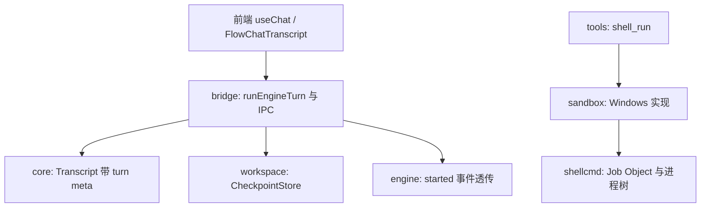

# 系统设计：按轮回退 + Windows 命令沙箱（2026-10-30）

范围：`docs/architecture-clarity-and-harness-gap-2026-10-30.md` 里剩下的两项（差距 ③ 的“按轮回退”，§4 P2 的“Windows 命令沙箱”）。`go.mod` 单独 tidy 已完成，不在本文范围。

状态：**已实现并验证**（2026-10-30）。施工中与上文不一致的地方记在 6.1，验证了什么、没验证什么记在 6.2；上文保持设计时的原样，读到与 6.1 冲突的地方以 6.1 为准。没有提交，改动都在工作区里。

---

## 0. 目标与约束

### A. 按轮回退

| 项 | 内容 |
| :--- | :--- |
| 交付物 | 每个用户轮次开始前自动做一个工作区检查点；界面上每条用户消息可“回到这一轮之前”，先预览改动再确认；回退前自动留一个安全检查点，可撤销这次回退 |
| 规模 | 与现有审阅一致：单文件 ≤ 8 MiB，一个会话保存的内容 ≤ 128 MiB；工作区忽略规则与审阅面板一致（`.git`、`node_modules`、`build` 等不在范围内） |
| 运行环境 | 桌面（Wails）与 Web 两种形态；Go 侧纯内存，不依赖 CGO |
| 预算 | 创建检查点：未变化的文件只做 `stat`，变化的才读内容；20 秒超时；每会话最多 30 个检查点；全局内容预算 512 MiB |
| 成功标准 | ① 回退后文件字节与检查点一致（哈希相等）；② 不相关的文件不被碰；③ 撤销回退能还原回退前状态；④ 经 `runEngineTurn` 的入口（桌面、Web、无头/MCP）都建检查点；⑤ 检查点失败不阻塞对话；⑥ 内存有上界 |

### B. Windows 命令沙箱

| 项 | 内容 |
| :--- | :--- |
| 交付物 | `AGENTGO_SANDBOX_OS=1` 在 Windows 上生效：`execute_bash` 的命令只能写命令工作目录子树和一个私有临时目录；命令树仍在现有 Job Object 里 |
| 做不到的 | **网络隔离、读取隔离**。低完整性不限制读，也不限制网络（本机实测，见 4.3）。因此这是“防误伤”沙箱，不是“防泄密”沙箱 |
| 规模 | 给工作区打标签的成本约 0.2 ms/对象（实测 3050 个对象 573 ms） |
| 运行环境 | Windows Vista 及以上、NTFS；Win7 32 位发布包也编译进去，但**没有在 Win7 实机验证** |
| 成功标准 | ① 沙箱内命令能改工作区已有文件、新建文件；② 写工作区外、`%TEMP%`、HKCU 注册表被拒；③ 默认（不允许网络）配置下**拒绝执行**而不是悄悄放行；④ 任何准备步骤失败都拒绝执行（fail-closed） |

---

## 1. 系统结构

### 1.1 模块与依赖方向（只加不改层级，`layers.go` 不变）



### 1.2 模块说明

| 模块 | 职责 | 对外接口 | 不负责 |
| :--- | :--- | :--- | :--- |
| `workspace.CheckpointStore`（新 `checkpoint*.go`） | 生成检查点清单、内容寻址存内容、预览和执行回退、自动安全检查点、预算与回收 | `Begin` / `List` / `Preview` / `Rollback` / `Clear` | 不认识会话消息、界面、IPC |
| `core.WithTurnMeta`（新 `turnmeta.go`） | 把“这一轮的附加元数据”放进 `ctx`，`Transcript.Begin` 写用户消息时合并进 `meta` | `WithTurnMeta` / `TurnMetaFrom` | 不知道检查点是什么 |
| `engine.Router` | 把调用方在 `RunRequest.Meta["started_payload"]` 里给的一小块数据原样放进 `started` 状态事件的 payload | 无新增类型（协议规定消费方忽略未知字段） | 不解释内容 |
| `bridge`（新 `workspace_checkpoint.go`） | 在 `runEngineTurn` 开头建检查点；IPC：列表、预览、回退；运行中拒绝回退 | `ListTurnCheckpoints` / `PreviewTurnRollback` / `RollbackToTurn` | 不实现快照算法 |
| 前端 | 从 `started` 事件和历史消息的 `checkpoint` 字段拿到 ID；按钮、预览对话框 | — | 不猜轮次序号 |
| `sandbox`（新 `os_windows*.go`） | 低完整性令牌、给可写目录打低完整性标签、拼出带令牌的命令 | 复用 `Command` / `Confine` / `Available`；新增 `Guarantees()` | 不做网络和读取隔离 |

### 1.3 配置外置清单

| 项 | 位置 | 默认值 | 是否已验证 |
| :--- | :--- | :--- | :--- |
| 单文件内容上限 | `workspace.CheckpointLimits.MaxFileBytes` | 8 MiB | 沿用审阅现值，未针对检查点单独验证 |
| 每会话内容预算 | `CheckpointLimits.MaxSessionBytes` | 128 MiB | 同上 |
| 全局内容预算 | `CheckpointLimits.MaxGlobalBytes` | 512 MiB | **未验证**，拍的数 |
| 每会话检查点数 | `CheckpointLimits.MaxPerSession` | 30 | **未验证** |
| 扫描文件数上限 / 超时 | `MaxFiles` / `ScanTimeout` | 200000 / 20 s | **未验证** |
| 检查点总开关 | `config` 新增 `AGENTGO_CHECKPOINTS`（默认开） | 开 | — |
| Windows 沙箱 | 沿用 `AGENTGO_SANDBOX_OS` / `AGENTGO_SANDBOX_OS_NET` | 关 | — |
| 沙箱标签的目录数上限 | `sandbox` 内常量 `maxLabelObjects` | 400000 | **未验证** |

限额由 `bridge` 从 `config` 读出后传进 `NewCheckpointStore(limits)`，`workspace` 不 import `config`。

### 1.4 新旧共存

- 现有审阅（`ReviewStore`：接受/拒绝本会话全部未接受改动）**完全不动**。检查点是新增的、独立的一套，二者各管各的：审阅回答“这一阵 AI 改了什么”，检查点回答“回到某一轮之前”。
- 回退后**不去动审阅基线**：审阅比较的是“基线 vs 现状”，回退只是把现状换了个值，比较结果依然准确。
- 沙箱：Linux/macOS 实现不动；Windows 从 `os_other.go` 的 fail-closed 拆出独立实现，开关仍是 `AGENTGO_SANDBOX_OS`，默认关。

---

## 2. 数据结构

### 2.1 实体表（A：检查点，全部在内存）

| 实体 | 主键 | 关键字段 | 归属 | 类别 | 版本字段 | 体积估算 |
| :--- | :--- | :--- | :--- | :--- | :--- | :--- |
| `Checkpoint` | `cp_<毫秒时间>_<6位随机十六进制>` | `SessionID`、`Root`、`Kind`（`turn` / `pre_rollback`）、`Seq`（会话内递增）、`Prompt`（≤80 字）、`CreatedAt`、`Files`、`Skipped` | `workspace` | 派生（可由磁盘重算但过去的状态不可重算，所以按“不可重算”对待：丢了就是丢了） | 无（不落盘，不需要） | 清单每个文件约 100 B，10 万文件约 10 MB |
| `fileRef` | 清单里的相对路径 | `Hash`（sha256）、`Size`、`ModTime`、`Mode`、`Restorable`、`Binary` | `workspace` | 同上 | — | — |
| `blob` | 内容哈希 | 字节、引用计数 | `workspace` | 同上 | — | 每会话 ≤128 MiB，全局 ≤512 MiB |
| 用户消息 meta | 消息 ID（已有） | 新增 `checkpoint`: 检查点 ID | `core` / `sessions` | 源 | — | 几十字节 |

关系都用 ID 引用：用户消息 `meta.checkpoint` → `Checkpoint.ID`；`Checkpoint.Files[path].Hash` → `blob`。检查点之间共享 `blob`，所以每多一轮只新增“这一轮被改过的文件”的内容。

### 2.2 为什么不用“按位置数第几轮”

`GetSessionMessages` 只返回最新 200 条，前端数出来的“第 N 轮”在长会话里和库里的序号对不上，所以**不按序号对应**，而是把检查点 ID 写进用户消息的 `meta`（`GetSessionMessages` 本来就会把 `meta_json` 合并进消息行），实时那一轮靠 `started` 事件带回 ID。没有 ID 的消息（旧会话、应用重启后检查点已消失）不显示回退按钮。

### 2.3 存储

| 数据 | 格式 | 位置 | 写入方式 | 备份 |
| :--- | :--- | :--- | :--- | :--- |
| 检查点清单与内容 | Go 内存结构 | 进程内 | 每会话一把互斥锁 + 全局预算一把小锁 | **不持久化**，重启即丢（见第 6 节） |
| 用户消息 `meta.checkpoint` | SQLite `chat_messages.meta_json` | 现有库 | `AppendMessage`（已有） | 随会话库 |
| 回退时写文件 | 工作区文件 | 工作区 | 同目录临时文件 + `Rename` | `pre_rollback` 检查点 |
| Windows：沙箱标签 | NTFS 强制完整性标签（SACL 里的 `ML` ACE） | 可写目录子树 | `SetNamedSecurityInfo` 一次调用，系统自动传播 | 提供 `ClearLowLabel`；也可手动 `icacls <目录> /setintegritylevel M /T` |
| Windows：沙箱私有临时目录 | 目录 | `%TEMP%\agentgo-sandbox` | 创建后打低标签 | 可删除，下次自动重建 |

### 2.4 版本与失效

检查点不落盘，没有版本问题。失效条件：① 工作区根变了（`Clear`）；② 会话被删（`Drop`）；③ 超预算被回收；④ 进程重启。四种情况前端都表现为“没有可用检查点”。

---

## 3. 数据流

### 3.1 总流程

```
用户发送 → [runEngineTurn] → ① 建检查点（扫描工作区，复用上一份的 stat 缓存）
                              → ② ctx 带上 turn meta；RunRequest.Meta 带 started_payload
                              → ③ Transcript.Begin 写用户消息（meta.checkpoint）
                              → ④ engineRouter.Run → started 事件（payload.checkpoint_id）→ 前端给最后一条用户消息打标记
回退：前端点按钮 → PreviewTurnRollback（只读）→ 用户确认 → RollbackToTurn
        → 拒绝运行中 → 预检（有不可还原项则整体拒绝）→ 建 pre_rollback 检查点 → 逐文件写入/删除 → 返回 undo_checkpoint_id
撤销回退 = 对 undo_checkpoint_id 再做一次 RollbackToTurn
```

### 3.2 阶段表（A）

| 阶段 | 输入 | 处理 | 输出 | 输出上限 | 幂等 / 续跑 | 内存上界 |
| :--- | :--- | :--- | :--- | :--- | :--- | :--- |
| 建检查点 | 会话、工作区根 | 遍历；`size+mtime` 与上一份相同则复用哈希；不同则读内容、算哈希、必要时入 blob | `Checkpoint` | 20 万文件、单文件 8 MiB | 幂等（重复调用多一份检查点，内容共享） | 受 blob 预算限制 |
| 预览 | 检查点 ID | 扫描现状，与清单比较 | 动作列表（还原 / 重建 / 删除 / 阻塞） | 返回前 200 条，另给总数 | 只读 | 清单大小 |
| 回退 | 同上 | 预检 → `pre_rollback` → 执行 | 结果与 `undo_checkpoint_id` | — | 可重试：已回退的文件再比较时无差异；失败的会报告 | 同上 |
| 回收 | 新增字节超预算 | 先删本会话最老的检查点，再删最近最少使用会话的最老检查点；释放无引用的 blob | — | — | — | — |

### 3.3 失败路径（A）

| 故障 | 检测 | 处理 | 用户可见提示 |
| :--- | :--- | :--- | :--- |
| 工作区根为空或不存在 | 建检查点时 | 跳过，不报错 | 无按钮 |
| 扫描超时 / 文件过多 | `ScanTimeout` / `MaxFiles` | 放弃这个检查点，释放已加入的 blob，**对话照常进行** | `started` 事件带 `checkpoint_error`，前端提示一次“这一轮没有回退点：原因” |
| 单文件超 8 MiB 或预算耗尽 | 读内容时 | 只记哈希，`Restorable=false`，计入 `Skipped` | 预览里标“不可还原” |
| 回退时会话正在运行 | `engineRouter.Active()` | 拒绝 | “先停止当前运行，再回退” |
| 工作区根与检查点不同 | `SamePath` | 拒绝 | “检查点属于另一个工作区” |
| 有不可还原项 | 预检 | **整体拒绝**，列出前几个路径 | 预览对话框里标红，确认按钮不可用 |
| 目标路径现在是目录、或父目录是符号链接出了根 | 预检 `Lstat` / `FullPath` | 该项标阻塞，整体拒绝 | 同上 |
| 写入某个文件失败（被占用等） | 执行时 | 继续其余文件，结果里列出 `failed`；已建的 `pre_rollback` 可撤销 | “部分文件没能还原”，列出路径 |
| 检查点已被回收或进程重启过 | 查不到 ID | 返回明确错误 | 按钮置灰，提示原因 |

### 3.4 可观测

建检查点记录：文件数、新增 blob 字节、耗时、跳过数，写 `applog`；回退记录：还原 / 重建 / 删除 / 失败数。

### 3.5 数据流（B：Windows 命令沙箱）

```
runShell → sandbox.Confine → Command(policy)
   ① 校验：没有允许网络 → 拒绝（Windows 无法隔离网络，默认配置必须 fail-closed）
   ② 路径：WriteRoots 里等于系统临时目录的换成 %TEMP%\agentgo-sandbox（命令的 TEMP/TMP 也指过去）
   ③ 每个可写根：必须是绝对路径、存在、是目录、在 NTFS（支持 ACL）、不过宽（不是盘根 / 用户配置目录本身及其上级 / Windows / Program Files）
      已打过低标签则跳过；否则先限量计数（≤ maxLabelObjects），再 SetNamedSecurityInfo(低标签, OICI) 一次完成
      拒绝访问 → 报“需要 WRITE_OWNER”的明确错误（不静默降级）
   ④ 令牌：进程内缓存一份“去特权 + 管理员组 deny-only + 低完整性”的主令牌（先 CreateRestrictedToken，再复制，最后设完整性级别）
   ⑤ 命令：shellcmd.Command(...) + SysProcAttr.Token；env 里 TEMP/TMP 改成私有临时目录
   ⑥ shellcmd.Run：沿用现有“挂起启动 → 进 Job → 恢复”，Job 的内存和进程数限制照旧
```

| 故障 | 检测 | 处理 |
| :--- | :--- | :--- |
| 创建令牌失败 | API 返回错误 | 拒绝执行，错误带系统错误码 |
| 可写目录不在 NTFS / 不支持 ACL | `GetVolumeInformation` 的 `FILE_PERSISTENT_ACLS` | 拒绝执行 |
| 打标签被拒绝 | `ERROR_ACCESS_DENIED` | 拒绝执行，提示“对该目录需要‘更改所有者’权限；用户配置目录下的项目可直接用，其他盘需先在目录安全属性里给自己完全控制” |
| 可写根过宽 | 路径规则 | 拒绝执行 |
| 对象数超限 | 限量计数 | 拒绝执行，提示在更小的子目录里启用 |
| 启动后进不了 Job | 沿用 `BestEffort` | 与现状一致（记日志，命令仍在受限令牌下运行） |

---

## 4. 本机实测结论（Windows 11 26300，标准用户、未提权，探针放在临时目录里）

### 4.1 标签怎么传播

对目录调**一次** `SetNamedSecurityInfo(LABEL_SECURITY_INFORMATION)`，系统自动把标签传给**已有**子文件和子目录（它们的 SDDL 变成 `S:AI(ML;ID;NW;;;LW)`，`ID` 表示继承），之后新建的文件也自动继承。

### 4.2 打标签的成本（3050 个对象）

| 做法 | 用时 |
| :--- | :--- |
| 对根目录调一次 `SetNamedSecurityInfo` | 573 ms |
| `TreeSetNamedSecurityInfo` | 911 ms |
| 逐路径循环 | 2.5 s |

采用第一种。约 0.2 ms/对象，10 万对象约 20 秒，是**一次性**成本（已打过的目录靠检查根标签跳过）。

### 4.3 低完整性子进程的实际行为

| 动作 | 结果 |
| :--- | :--- |
| 改工作区（已打标签）里的已有文件 / 深层文件 / 打标签后才创建的文件 | 允许 |
| 新建文件、新建目录、删除已有文件 | 允许 |
| 孙进程写工作区 | 允许（令牌继承） |
| 改工作区外的文件 | **拒绝** |
| 写 `%TEMP%`（中完整性目录） | **拒绝**（所以必须重定向 TEMP） |
| 写 HKCU 注册表 | **拒绝** |
| 读工作区外的文件 | **允许**（读取不受限） |
| 回环 TCP 连接 | **允许**（网络不受限） |

“去特权”那一版令牌的结果与只降完整性级别的一致；当前机器的令牌本来就是被 UAC 过滤的（管理员组已是 deny-only），所以看不出差别——它的价值在**提权运行**时：去掉 `SeBackup`、`SeRestore`、`SeDebug` 等特权，否则这些特权能绕过访问检查。

### 4.4 一个会咬人的前提

打低标签需要对目录有 `WRITE_OWNER`。在用户配置目录下（本仓库所在位置）用户是完全控制，可以；在盘根下的临时目录这种只继承了“Authenticated Users：修改”的目录里，**`SetNamedSecurityInfo` 返回拒绝访问**（本机已复现）。所以放在非用户目录的项目要先改权限，设计里选择报错说明，不自动改用户的 ACL。

### 4.5 这台机器上已有 OpenAI Codex 的 Windows 沙箱

`icacls` 显示仓库目录上有 `CodexSandboxUsers` 组的 ACE，临时目录上有几个能力 SID 的 ACE。这印证业界做法也是“改 ACL 授权可写目录”，只是它用了专用本地账户 + 防火墙规则（需要管理员一次性初始化），能做网络隔离；我们这版不需要管理员，代价是做不到网络隔离。

---

## 5. 里程碑

| 阶段 | 内容 | 完成标志 |
| :--- | :--- | :--- |
| M1 | `workspace.CheckpointStore` + 单元测试 | 创建 / 回退 / 撤销 / 预算回收 / 超时 / 大文件 / 并发测试通过 |
| M2 | `core.WithTurnMeta`、`engine` 透传 `started_payload`、`bridge` 钩子与三个 IPC | bridge 测试：一轮之后用户消息带 `checkpoint`；运行中拒绝回退；回退再撤销 |
| M3 | 前端：契约、白名单、mock、`useChat` 打标记、按钮与预览对话框 | `tsc`、前端测试、`npm run build` 通过 |
| M4 | Windows 沙箱：令牌、标签、`Command`，接入 `shell_run`，改 `flags.go` 文案 | Windows 实机测试覆盖 4.3 表里每一行 + 默认配置拒绝 + 标签失败拒绝 |
| M5 | 文档与全量验证 | `go build` / `vet` / 受影响包测试、`-tags web`、386（legacy 工具链和普通工具链）、交叉编译 |

每个里程碑结束跑同一套基线：`go build ./...`、`go vet ./...`，以及受影响包的测试。

---

## 6. 风险与未验证项

| 风险或未验证默认值 | 影响 | 对策 |
| :--- | :--- | :--- |
| 检查点只在内存，重启后消失 | 重启后看不到旧轮次的回退按钮 | 界面置灰并说明；持久化到磁盘留作下一步（需要落盘位置、原子写入、随会话删除） |
| 每轮开头多一次扫描（审阅的 `Begin` 已经扫一次） | 超大工作区每轮开头多花一次元数据遍历 | 靠 `size+mtime` 复用避免重读内容；超时放弃不阻塞；真有问题再合并两次扫描 |
| 回退会覆盖检查点之后用户**手动**做的修改 | 误伤 | 预览对话框明说；回退前自动留 `pre_rollback`，可撤销 |
| `.git`、被忽略目录、超 8 MiB 文件不在范围内 | 回退不完整 | 预览与文档如实说明；忽略规则与审阅面板一致 |
| ACP 与终端“快速修复”直接调 `sendMessageCore`，不经 `runEngineTurn` | 这两个入口不建检查点 | 本次不覆盖，文档记录 |
| 回退不改对话上下文 | 模型可能以为被回退的改动还在 | 回退后向会话追加一条系统提示（若 `BuildHistory` 接受该角色），否则只在界面提示；不做“同时回退对话”（需要截断/分叉，留作下一步） |
| Windows：只能防写，不能防读和网络 | 命令仍可读取并外传用户文件 | 默认配置拒绝执行，必须显式设 `AGENTGO_SANDBOX_OS_NET=1` 表示接受；`Guarantees()` 与文档如实说明 |
| Windows：工作区内 `.git/hooks`、脚本可被沙箱内命令改写，之后由未受限的用户命令执行 | 沙箱逃逸路径 | 与 Linux/macOS 的“工作区可写”策略等同；文档提示，不在本次加固 |
| Windows：从工作区外**移动**进来的文件保留原标签 | 沙箱内无法改这些文件 | 文档说明；重新启用沙箱前对目录再打一次标签即可（检查根标签后会跳过，需手动 `icacls` 或 `ClearLowLabel` 后重来） |
| Windows：打标签需要 `WRITE_OWNER` | 非用户目录的项目用不了 | 明确报错（4.4），不自动改 ACL |
| Windows：沙箱内工具写缓存目录（GOCACHE、npm、pip）会被拒 | 构建类命令失败 | 只重定向 TEMP/TMP；其他缓存目录需要用户在命令里指向工作区或私有临时目录；`AGENTGO_SANDBOX_OS_WRITE` 留作下一步 |
| Windows：Win7 / Server / 网络共享 / 非 NTFS 卷未实测 | 行为未知 | 非 NTFS 一律拒绝；Win7 仅保证编译通过，需实机验证后才能对外声明支持 |
| Windows：低完整性标签会残留在用户目录上 | 其他低完整性进程（如浏览器沙箱子进程）也能写这些目录；之前启用过沙箱的别的工作区里的沙箱命令也能写 | 文档里写明手动命令 `icacls <目录> /setintegritylevel M /T`（`ClearLowLabel` 没做，见 6.1） |

### 6.1 施工中的偏离（按模块）

**按轮回退**

| 设计里写的 | 实际做的 | 原因 |
| :--- | :--- | :--- |
| 有不可还原项时**整体拒绝**回退（3.3） | **跳过并如实报告**：三种文件不动并在预览里列出（原始内容没存下来；现在的内容太大没法留安全副本；建检查点时读不出来），其余照常还原；确认按钮不因此禁用 | 整体拒绝意味着工作区里只要有一个大于 8 MiB 的文件被改过，这一轮就永远回退不了。跳过不会毁掉任何东西，原则还是“不做无法撤销的事” |
| `RunRequest.Meta["started_payload"]` 把数据放进 `started` 事件（1.2） | `engine.RunRequest.StartedExtra`（有类型的字段），`Router` 用 `startedExtra` 过滤，调用方不能覆盖保留键（如 `state`） | 无类型的 `Meta` 里放一块可被覆盖状态的数据太容易出错 |
| 运行中检测用 `engineRouter.Active()`（3.3） | `rollbackBusyReason`：先用切换工作区的忙碌判断（`workspaceBusyReason`），再加上路由器里**任何引擎**的运行（不只是内置智能体），有一个就拒绝 | 别的引擎的运行也在同一个文件夹里干活，文件在它们脚下被换掉会出错 |
| 扫描超时/文件过多只放弃本次（3.3） | 另外把这个工作区**暂停建检查点 10 分钟**（`ErrCheckpointPaused`） | 已知会失败的扫描不该让每一轮都白等 20 秒 |
| 回退后向会话追加系统提示，“若 `BuildHistory` 接受该角色”（6 的风险表） | 追加一条 assistant 文本消息，meta 为 `{kind: "workspace_rollback", rollback_target, undo_checkpoint}`；模型看得到，界面画成分隔线。meta 键用 `rollback_target`，不用 `checkpoint` | `checkpoint` 键表示“这条用户消息可以回退”，说明消息不能占用它 |
| 前端按钮、预览框、撤销条（M3） | 另外：撤销条的状态放在**模块级、按会话分的表**里（`useTurnRollback.ts`） | 回退后 `reload()` 会让 `ChatPanel` 卸载再挂载 `FlowChatTranscript`，组件内部状态会丢；浏览器里端到端走一遍时发现 |
| 实时那一轮靠 `started` 事件给最后一条用户消息打标记 | 只有**发起这一轮的标签页**才打标（`initiatedHere`），也不做“找不到就按位置猜”的兜底 | 兜底会把别的用户消息错标成这一轮，后果是回退到错误的时间点 |
| IPC 默认超时 15 秒 | `PreviewTurnRollback`、`RollbackToTurn` 设为 60 秒（`frontend/src/shared/ipc/call.ts`） | 大工作区扫描和写回可能超过 15 秒 |
| 失效条件“工作区根变了（`Clear`）”（2.4） | 一致，但明确了边界：只在**真的换了工作区**时清除（`workspace_runtime.go`），把同一个文件夹再设置一次不清 | 清掉会让按钮无故消失 |
| 设计里没有提浏览器预览（mock）运行时 | mock 里实现了建检查点、预览、回退、撤销，并用对话里的“改文件”字样模拟一轮改动（`frontend/src/shared/ipc/mock/checkpoints.ts`）。它只是个模拟，不是 Go 实现的复刻 | 没有 mock，浏览器预览里就没法验证按钮和对话框 |
| — | **顺带修了一个老 bug**：`FlowChatTranscript` 自己调 `useChat()`，而它不是单例，拿到的是空会话（`sessionId` 为空串），所以“↶ 撤销未接受改动”点了没有任何效果。现在用 `AppShell` 注入的上下文 | 做回退按钮时发现 |

**Windows 命令沙箱**

| 设计里写的 | 实际做的 | 原因 |
| :--- | :--- | :--- |
| 新增 `Guarantees()` 描述各平台的保证 | **没做** | 没有调用方，会变成死代码。保证写在报错文案、`flags.go` 的开关说明和 `docs/ARCHITECTURE.md` 第 12 节里 |
| 提供 `ClearLowLabel` 撤销标签 | **没做** | 同上。文档给出手动命令 `icacls <目录> /setintegritylevel M /T` |
| 私有临时目录在 `%TEMP%\agentgo-sandbox`（2.3、3.5） | 改到 `%LOCALAPPDATA%\agentgo\sandbox-tmp`（`os.UserCacheDir()`，沿用 `computeruse/token.go` 的惯例） | 跑 `go test` 时发现：`GOTMPDIR` 或用户把 `TEMP` 指到别的盘时，那里没有 `WRITE_OWNER`，沙箱整体用不了；放在用户目录下就与 `TEMP` 指到哪无关 |
| 打标签被拒时提示需要 `WRITE_OWNER` | 报错里直接给出可用的命令：`icacls "<目录>" /grant "%USERNAME%:(OI)(CI)F" /T` | 让用户一步到位 |
| `maxLabelObjects` 是常量（1.3） | 包级变量，默认值不变 | 只为了让测试能把上限调低 |
| “过宽”规则含盘根、用户目录及其上级、Windows、Program Files | 另外含 `ProgramData`；网络盘、光驱、非 NTFS 另有检查（`GetDriveType`、`FILE_PERSISTENT_ACLS`） | 补全 |
| 沙箱默认可用性由 `Available()` 反映 | `Available()` 表示“能造出受限令牌”，探测一次并缓存；在 Windows 上默认配置仍拒绝执行（没设 `AGENTGO_SANDBOX_OS_NET=1`） | `Available()` 不等于“能防泄密”，不能让调用方误解 |
| `TestConfineFailsClosedWhereUnsupported`（Windows 上原本会执行） | 现在 Windows 上 `Available()` 为真，该测试跳过；对应的拒绝行为由 `TestWindowsRefusesWithoutNetworkAcknowledgement` 和 `internal/tools` 里的端到端测试覆盖 | 行为变了，测试跟着变 |

### 6.2 验证记录

跑过的（都在这台 Windows 11 26300、标准用户、NTFS 上）：

| 检查 | 结果 |
| :--- | :--- |
| `go build ./...`、`go vet ./...` | 通过 |
| `go test -count=1`：`sandbox`、`shellcmd`、`tools`、`config`、`arch`、`bridge`、`workspace`、`core`、`engine`、`sessions`、`agent` | 全部 ok |
| Windows 沙箱实机测试 | `sandbox` 里 13 个、`tools` 里 1 个端到端（走 `runShell`，用它真正使用的 `TreeOptions{Detachable, BestEffort}`），**无一跳过** |
| 沙箱测试的变异检查 | 临时去掉“给进程套令牌”那一行：越界写、HKCU 写、完整性级别与特权、联接点写 4 个测试按预期失败；已还原 |
| 32 位版本 | `GOARCH=386` 的同一批沙箱测试在这台 64 位 Windows 上（WOW64）全部通过 |
| 构建矩阵 | `-tags web` 的 windows/amd64；`./internal/... ./cmd/agentgo-web/...` 在 386，普通与 Win7 旧工具链各一次；`agentgo-cli` 与 `agentgo-cua` 的 linux/amd64、linux/arm64、darwin/amd64、darwin/arm64、windows/arm64 |
| 其他平台的 `go vet` | linux/amd64（`sandbox`、`tools`、`config`）、linux/arm64、darwin/amd64（同三个包）、darwin/arm64、freebsd/amd64（`sandbox`，覆盖新的 `os_other.go` 标签） |
| 前端 | `npm run typecheck`、`npm test`（132 个，0 失败）、`npm run build` 通过 |
| 回退界面 | 浏览器里端到端走过（mock 后端）：打标、按钮实时出现、旧 ID 不显示按钮、预览与确认框、回退、说明分隔线、撤销条跨 `reload` 保留、撤销、撤销后的说明、原“撤销未接受改动”按钮 |
| 格式 | 32 个改动或新增的 Go 文件，换行归一成 LF 后都是 gofmt 干净的（本机 `core.autocrlf=true`，工作副本里 `router.go`、`shell_run.go` 是 CRLF，`gofmt -l` 会误报） |

**没验证的**：

- **Wails 桌面窗口里的回退界面**没有跑过。界面在浏览器预览（mock 后端）里走通，Go 一侧的 IPC 由 `bridge` 的测试覆盖，但“真实后端加真实界面”这条整链没有手动走过。
- **Win7 实机**没有跑。32 位版本只在 Windows 11 的 WOW64 里跑过。
- **Linux、macOS 沙箱**这次没有动，也仍然没有在真机上运行过；只验证了新增的构建标签没有把它们弄坏（交叉 `vet` 与构建）。
- **工作在 GitHub 上的工作流**没有跑过（与 10-30 白天的结论一样）。
- 沙箱在**提权运行**时的行为（去掉 `SeBackup`、`SeDebug` 等特权的实际效果）没有测：这台机器上的令牌本来就是被 UAC 过滤过的，测试能证实“只剩 `SeChangeNotifyPrivilege`”，但不能证实提权场景。
- 检查点的限额（全局 512 MiB、每会话 30 个、20 万文件、20 秒、暂停 10 分钟）是拍的数，没有用大工作区实测过。
