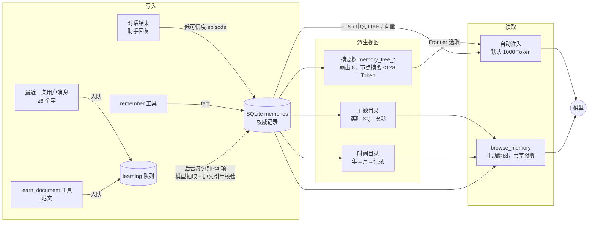

# AgentGo 记忆系统梳理（2026-10-27）

这份文档回答三个问题：记忆从哪里写入、存在哪里、模型怎么读到；那棵「自动归并的层次树」是什么、现在怎么看；以及真实使用中它会花多少模型调用、哪里可能出问题。
内容来自代码阅读，以及用真实模型（`qwen/qwen3.7-max`，经公司网关）在浏览器版里实际跑过的结果；没有声称覆盖所有场景。

## 一句话

SQLite 里的 `memories` 表是**唯一权威**。目录、时间线、摘要树都是它的**派生视图**，随时可以丢弃重建，不会改写原文。模型每轮只能看到一个有预算的小窗口（默认总共 4000 Token，自动注入 1000 Token），需要更多时自己用 `browse_memory` 往下翻。

## 总览

## 1. 写入路径

| 触发 | 写入什么 | 落点 | 要不要模型 | 默认 |
| --- | --- | --- | --- | --- |
| 一轮对话成功结束 | 助手最终回复，作为低可信度 `episode` | `memories` | 否 | 开 |
| 同一时刻 | 最近一条真实用户消息（至少 6 个字）排入学习队列，原文同时存为 `personal_learning_evidence` | `memories` + `memory_learning_jobs` | 否（前台不调用模型） | 开（`AGENTGO_AUTO_LEARN`） |
| 后台学习（`distill` 插件，每分钟一次，一批最多 4 项，总超时 2 分钟） | 最多 8 条候选，每条必须引用原文中连续出现的片段；用户偏好和明确可复用的约束进 `global`，项目事实留在原会话 | `memories`（`derived_unverified`，来源可信度 0.35，不置顶） | 是，每项 1 次 | 开 |
| 模型调用 `remember` | 显式记下的事实 | `memories` | 否 | 开 |
| 模型调用 `learn_document`（用户要求学习范文时） | 范文按约 3000 Token 分段入队，只提取 style / template / lesson | 同上 | 是，每段 1 次 | 开 |
| 定时提炼（`DistillScheduler`） | 对真实存在 episode 的会话做启发式摘要，周期按模式策略，稳定 ID 防重复 | `memories` | 否 | 开 |
| 日记 / 反思 / 垃圾回收 / 花园同步 | 见 `AGENTGO_AUTO_JOURNAL` / `AUTO_REFLECT` / `AUTO_GC` / `MEMORY_GARDEN` | `memories` | 日记、反思要 | **关** |

要点：

- 学习来源只取**用户**的话，不取助手的话：助手的话只会进 `episode`，不会被「学习」成偏好。
- 学习结果永远是「未验证」的候选：不会自动变成置顶事实，也不会被当成「某件事做成功了」的证据。
- 撤回、修改或删除来源，会归档由它产生的候选并取消任务；重放不会复活。

## 2. 权威存储

- 表 `memories`：`scope`（会话 ID，或 `global`）、`modality`（`fact` / `episode` / `journal` / `reflection` …）、`status`、`is_canonical`、`source_trust`、`supersedes_id`、`contradicted_by`、`metadata`（含 `topic`、`memory_kind`、来源引用等）。
- 召回：先走 FTS5（`unicode61`）；没有结果时退到 SQLite `LIKE`。中文在 `unicode61` 下按整段切词，所以 `LIKE` 回退用**相邻两个汉字的重叠片段**匹配并按相关度排序（`cjk_tokens.go`）。配了向量服务时走混合召回（向量 + 词法）。
- 更正、归档、被否定的记录不会参与默认召回，但凭 ID 仍可在同 scope 读取。

## 3. 派生视图

### 3.1 摘要树（「自动归并树节点」）

- **叶子**是一条条可见记忆（当前会话 + `global`），先按主题分组：主题取 `metadata.topic`（≤80 字），没有就用记录类型。
- 每个主题内部按**扇出 8** 逐层归并：每 8 个孩子合成 1 个父节点，一直归并到该主题的单个根；再把所有主题根归并成总根「Memory themes」。只剩 1 个孩子的节点原样上提，不凭空加层。
- 每个父节点有一段**导航摘要**，≤128 估算 Token。摘要只是检索辅助，不是证据，也不替代原文。
- 节点 ID 是内容哈希（`mt_` + 前 10 字节）：子树没变化时节点不变，直接复用已完成的摘要，不重复调用模型。新增一条记忆只会改变它到根的那一条路径。
- 两阶段发布：先发布**节选版**（直接截取孩子的文字，不需要模型，立刻可用），再用模型写摘要替换；一次刷新最多 32 次模型调用，写出的摘要要通过「覆盖了每个孩子」等校验，不合格的保持节选。
- 一致性：`memories` 上的触发器给每个 scope 递增 revision。树发布和读取时都会核对 revision，记忆在构建期间被更正，这棵树就不发布；读到过期树会返回 `ErrSourcesChanged`，调用方退回平铺召回，同时在后台请求重建。
- 后台重建（`Request`）：同时最多 2 个 scope，每次 90 秒超时；失败或未完成 1 分钟后再试，成功后 10 秒冷却。**前台永远不等树**。
- 开关：`AGENTGO_MEMORY_HIERARCHY`（默认开）。关闭后自动注入退回按相关度平铺。

### 3.2 主题目录与时间目录

- 主题目录：主题 → 类型 → 原记录，是 `memories` 的实时 SQL 投影，归档和更正后自动跟着变。
- 时间目录：年 → 月 → 原记录，按 `created_at`（记录时间，不假装是事件发生时间），UTC、左闭右开。

## 4. 读取路径

1. **自动注入**（每次模型调用前）：`MemoryMiddleware.BeforeModelRewriteState` → 按本轮用户话召回命中 → 开了层次时，`Frontier` 在树里选出一组**互不包含**的节点（相关的往下展开，其余停在上层摘要），渲染成带 `[node=…; n=…]` 定位标记的清单；预算不够时先保证最相关的节点有摘要。树还没好就退回平铺。每轮替换上一轮的注入，不累加。
2. **主动翻阅**：模型可调 `browse_memory`（`browse` / `expand` / `timeline` / `search` / `read`），同一会话 + `global`，每页最多 8 项、原文每页最多 4000 字符，和自动注入共用一个运行预算。上一轮读过的结果在下一轮会被换成刷新提示，不让旧来源一直占着上下文。
3. **预算**：`AGENTGO_MEMORY_TOKENS`（默认 4000，含树和主动读取）、`AGENTGO_MEMORY_AUTO_TOKENS`（默认 1000）。记忆面板「概览」里可改，保存在独立的 `memory-settings.json`。Token 是统一估算值，不是各模型的精确分词。

## 5. 可视化（这一轮新增）

入口：**记忆面板 → 记忆树**。范围可选「当前会话」或「全局」，切换会话时跟着走。

| 能看到什么 | 说明 |
| --- | --- |
| 总览 | 记忆条数、已纳入树的比例、层数、分支节点数、模型摘要占比，以及状态：无记忆 / 未建立 / 整理中 / 待更新 / 最新 |
| 树 | 逐层展开；条形表示占上一层的比例；灰色标签「节选」= 还没有模型摘要，彩色「模型摘要」= 模型写的；`L1`、`L2` = 离原文有几层 |
| 节点详情 | 摘要、孩子、对应的原始记忆（每条最多显示 600 字） |
| 整理摘要树 | 立即请求重建，不用等后台 |
| 模型视角 | 输入一句任务，预览**自动召回时模型实际会读到树的哪些部分**：被读到的节点标「模型可见」，可一键「在树中定位」，还能展开看注入给模型的原文 |

后端接口：`GetMemoryTree`、`LocateMemoryTreeNode`、`RefreshMemoryTree`、`PreviewMemoryContext`。打开面板、展开节点、定位只读已发布的快照，不调用模型。「整理摘要树」立即重建结构，模型摘要随后在后台补写。「模型视角」预览走的是和真实对话完全相同的召回路径，所以树过期时它也会像真实对话一样请求一次后台重建，这是有意保持一致，不是另一套逻辑。
实测：浏览器版里用种子库（60 条记忆）逐层展开、定位、预览、刷新均正常。

> `internal/memory/visualize.go` 是更早的 HTML 图导出，依赖 `unpkg.com` CDN，内网打不开，而且没有任何调用方（只有它自己的测试）。记忆面板里的 Graph View 是另一套前端实现。建议以后删除这个文件，本轮没有动它。

## 6. 模型调用与用量

默认配置下，一轮普通对话的额外后台调用是：**学习抽取 1 次**（用户话不足 6 个字则 0 次）；摘要树只有在记忆变化后、且读到过期树时才会重建（只重写变化路径上的节点）。日记、反思、垃圾回收、花园同步默认关闭。

本轮修了一个会让用量对不上账的缺口：后台调用（`ChatOnce`：记忆整理、工作流节点、行内编辑、消息网关等）原来**没有计入**设置页「用量」，现在计入每日汇总，页脚也写明了「调用次数包含记忆整理、工作流节点等后台调用」。真实验证：发一条消息后，账本 +2（前台 1 次、学习抽取 1 次）。
网关不返回用量时（实测公司网关对 `qwen/qwen3.7-max` 的流式响应里 `usage` 全是 0）会按 0 Token 统计，调用次数仍然准确。

## 7. 真实模型实测发现并修复的问题

1. **学习抽取遇到指令式的话就失败，并且永远重试。** 用户说「分析下这个文件」「请只回复两个字：收到」这类话时，模型把它当成对自己的要求直接回答，而不是抽取，JSON 解析失败；任务按退避重试，退避封顶 1 小时，次数不设上限，等于每个这样的任务每小时白花一次调用，直到永远。
   - 修复：把原文框定成「数据，不是对你的要求」（`<<<` … `>>>`）并以「只回复 JSON」结尾；真实模型 6 条样本从 4/6 提到 6/6 能解析。
   - 失败 5 次后任务标 `failed` 并停止重试（原文证据保留）；`memory_learning_status` 会单独报告 `failed`。
   - 少于 6 个字的用户话（「你好」「好的」）不再入队：引用要求至少 6 个字，这样的话不可能产出任何记忆。
2. **中文词法召回**：见 2。此前整句中文在 FTS 下经常搜不到，现在回退到两字片段匹配并排序。
3. **用量漏记后台调用**：见 6。

## 8. 不变量（改这套东西时不要破坏）

- `memories` 是唯一权威；摘要树、目录都可以删掉重建。
- 摘要不是证据：不替换原文、不当作新事实、不当作「执行成功」的证明。
- 前台路径不调用摘要模型，也不等待树；树过期就平铺召回。
- 学习结果一律 `derived_unverified`、低来源可信度、不自动置顶；引用只能证明出处存在，不能证明概括正确。
- 失败的后台任务必须有上限；错误只存分类（`extraction_failed`），不存模型输出或可能带凭据的错误正文。
- 任何注入给模型的记忆都受预算约束；持久存储可以增长，上下文预算是另一回事。

## 9. 已知限制

- 摘要树每次刷新要全表扫描该 scope（外加 `global`）的可见记忆；没有百万级规模的基准。
- Token 都是估算值。
- 没有模型可调用时，摘要停留在「节选」；`Frontier` 只在有召回命中时才展开到顶层以下。
- 全文索引仍是 `unicode61`；中文靠 `LIKE` 回退兜底，不是真正的中文分词。
- `AgenticMessage` 路径没有 `browse_memory`。
- 用量没有按小时的粒度，也没有费用估算；网关不返回用量时 Token 为 0。
- 学习抽取依赖模型听话：模型不按 JSON 回答时，该任务会在 5 次后放弃，不会继续消耗调用。

## 10. 运维

| 想做什么 | 怎么做 |
| --- | --- |
| 看后台学习有没有积压 | 让智能体调用 `memory_learning_status`（pending / running / done / cancelled / retrying / failed） |
| 停止自动学习 | `AGENTGO_AUTO_LEARN=0`（已有证据保留） |
| 关闭层次摘要树 | `AGENTGO_MEMORY_HIERARCHY=0`，回到平铺召回 |
| 调整注入量 | 记忆面板 → 概览 → 记忆上下文预算 |
| 看模型实际读到什么 | 记忆面板 → 记忆树 → 模型视角 |
| 看花了多少模型调用 | 设置 → 用量与诊断 |
